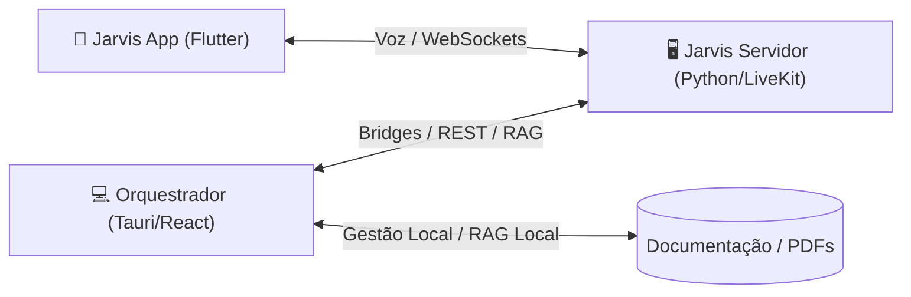

# Orquestrador Central · Desktop & Web

O **Orquestrador** é a interface central de comando e controle do ecossistema JARVIS e projetos integrados. Construído com **Tauri 2**, **React** e **TypeScript**, ele integra painéis de controle, motor local de **RAG (Retrieval-Augmented Generation)**, relatórios automatizados de agentes de IA e pontes de comunicação entre o computador pessoal e o servidor central.

---

## 🌐 O Ecossistema Integrado

O ecossistema é dividido em três pilares complementares:



1. **[Orquestrador](.) (este repositório):** Interface para desktop (Windows/Linux) e Web para gestão de tarefas, RAG local, templates de IA e central de relatórios de agentes.
2. **[Jarvis Servidor](../jarvis-servidor):** Backend de voz, orquestração de IA e APIs de automação rodando no servidor.
3. **[Jarvis App](../jarvis-app):** Aplicativo móvel e desktop em Flutter para conversação em tempo real, monitoramento de cotas de IA e notificações em segundo plano.

---

## ✨ Principais Funcionalidades

- **Motor RAG Local Integrado:** Indexador e buscador vetorial baseado em ChromaDB e modelos locais de embedding (Ollama / HuggingFace), capaz de processar documentações e bibliotecas técnicas em Markdown e PDFs pesados.
- **Painel de Relatórios de Agentes:** Visualização e sincronização de status de tarefas dos agentes de codificação (**Claude Code**, **OpenAI Codex** e **Antigravity**).
- **Pontes de Comunicação Seguras (Bridges):** Execução local de scripts auxiliares sem exposição de chaves privadas ou tokens de rede.
- **Interface Híbrida (Tauri 2 + Vite):** Alta performance em desktop nativo Windows com consumo mínimo de memória RAM comparado ao Electron.
- **Gerenciador de Prompts e Templates:** Biblioteca integrada de templates de engenharia de prompt para raciocínio, refatoração e testes.

---

## 🛠️ Tecnologias Utilizadas

- **Frontend:** React 18, TypeScript, Vite, Tailwind CSS, Lucide Icons
- **Desktop Runtime:** Tauri 2 (Rust)
- **Serviços & RAG:** Python 3.10+, ChromaDB, PyMuPDF (`fitz`), aiohttp
- **Comunicação:** WebSockets, REST APIs, MCP (Model Context Protocol)

---

## 📂 Estrutura do Repositório

```text
orquestrador/
├── src/                        # Aplicação React + TypeScript (UI, componentes e páginas)
├── src-tauri/                  # Configurações nativas do Tauri 2 em Rust
├── services/                   # Bridges locais e wrappers de comunicação Python/Node
├── scripts/                    # Scripts de automação, publicação e manutenção
├── deploy/                     # Manuais e templates de implantação de catálogo n8n
├── docs/                       # Documentação arquitetural e especificações
├── documentacao_rag/           # Base de conhecimento e artigos para o RAG local
└── TemplatesIA/                # Biblioteca de templates de prompts e agentes
```

---

## 🚀 Como Executar

### 1. Pré-requisitos
- **Node.js** 18+ e **npm**
- **Rust** e Cargo (apenas para compilar a versão desktop nativa Tauri)
- **Python** 3.10+ (para serviços de RAG e pontes locais)

### 2. Instalação das Dependências Web
```bash
npm install
```

### 3. Execução em Modo Desenvolvimento Web
```bash
npm run dev
```
Acesse `http://localhost:1420` no seu navegador.

### 4. Execução em Modo Desktop (Tauri)
```bash
npm run tauri dev
```

---

## ⚙️ Variáveis de Ambiente

Copie o `.env.example` caso precise configurar conexões personalizadas com o servidor Jarvis:
```bash
cp .env.example .env
```
Variáveis suportadas:
- `JARVIS_API_URL`: URL do servidor de controle do Jarvis (padrão: `http://localhost:8091`).
- `RAG_EMBEDDING_MODEL`: Modelo utilizado para embeddings no ChromaDB local.
