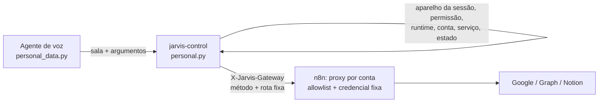

# Continuidade: integrações pessoais do Jarvis

Atualizado em 24/10/2026 (UTC). Complementa [o plano](plano-integracoes-pessoais-jarvis.md).

## Estado

| Etapa | Estado |
| --- | --- |
| 1ª entrega (preferências, permissão por aparelho, tela Conexões, apps 1.7.0 (26)) | Publicada em 23/10 |
| n8n de produção preparado (callback, segredo, esqueletos de credencial, 4 workflows) | **Feito no servidor** |
| Backup criptografado e teste de restauração | **Procedimento testado** antes das credenciais reais |
| Gateway, estados, 6 ferramentas, verificação, ferramentas no agente | **Pronto, aplicado localmente e empacotado** |
| Publicação do runtime | **Pendente: você roda** `scripts\publicar-runtime-pessoal.cmd` (sudo) |
| Proprietário n8n, clientes OAuth, login das contas, Notion | **Pendente: só você** ([guia](../deploy/personal-integrations/README.md)) |
| Verificar e ligar | **Pendente:** `scripts\verificar-conexoes-pessoais.cmd` |
| Simulações de voz dos cenários novos | **Parcial:** 2 de 5 passaram; correções não revalidadas (cota Gemini esgotada) |

Nada muda para o usuário até as contas serem verificadas e o runtime ligado. Até lá
a tela Conexões continua mostrando "Aguardando configuração e autorização".

## Decisão de arquitetura (desvio do item 5 anterior)

O plano previa `MCPToolset` no LiveKit falando direto com o MCP do n8n. A
implementação usa o **`jarvis-control` como gateway** e o n8n como **proxy de
credenciais** chamado por webhook. Motivo concreto: o item 4 exige autorizar cada
execução pelo aparelho da sessão. Só o `jarvis-control` tem o banco de aparelhos e
sessões. Com MCP direto, o agente guardaria o segredo do n8n, e a autorização seria
apenas consultiva. O plano já previa esse caminho ("webhooks autenticados e pequenas
`function_tool` Python"). Consequências:

- O agente não guarda nenhum segredo do n8n. Ele chama a API interna
  (`127.0.0.1:8091`) com o nome da sala.
- Os esquemas das ferramentas ficam fixos no código do Jarvis, e não no n8n.
- Não foi preciso adicionar o extra `mcp` nem mexer no `uv.lock`.
- Os contratos das ferramentas não dependem do transporte. Trocar por MCP depois não
  muda a interface vista pelo modelo.



## O que foi entregue nesta etapa

**Gateway (`src/jarvis_control/personal.py`).** A cada chamada, verifica: runtime
ligado, sessão ao vivo da sala, aparelho `app` ativo com `personal-access`, conta
habilitada, serviço selecionado **e verificado**, estado `connected`. Revogar o
acesso, pausar a conta ou desligar o runtime vale já na próxima chamada da mesma
sessão. Os argumentos são validados antes de qualquer requisição: campos extras,
datas, período de até 62 dias, limites, IDs, cursor. Resultado parcial por conta. Um
401 do provedor marca a conta como `expired`.

**Ferramentas.** São as seis do contrato proposto, com o envelope `schema_version`,
`items`, `sources`, `queried_at`, `partial`, `errors`, `next_cursor`, mais `notice`
(o conteúdo não é instrução). Cada item traz `account_id` e `source_id`.

- Calendário: todas as agendas visíveis (até 10 por conta), recorrências expandidas,
  dia inteiro com fim inclusivo, horário de São Paulo, evento compartilhado
  consolidado com `also_in`.
- Drive: busca por nome/conteúdo. Leitura de Docs/Slides (texto), Sheets (CSV), texto
  e PDF com texto, até 10 MB. PDF sem texto vira `no_text`.
- E-mail: Gmail e Outlook juntos, por data. A leitura usa somente GET, sem alterar
  flags.
- Notion: bases compartilhadas com a integração (até 5). Título, status, prazo e
  projeto são detectados pelos nomes e tipos reais. "Concluído" vem do grupo
  *Complete* do status.

**Estados.** `setup_required → authorizing → connected`, além de `expired`, `error`,
`disconnected` e `paused` (pausa vinda do app, que preserva o estado). Somente
`personal-verify` leva a `connected`: identidade + uma consulta real por serviço
selecionado. Identidade diferente da verificada antes vira `error identity_changed`.
A identidade fica em tabela privada e não aparece na API do app.

**API.** `GET /v1/integrations` agora traz o status real, `checked_at` por conta e
`phase: active`/`runtime_enabled: true` quando ligado. Internas, só para o agente:
`GET /internal/v1/personal?room=` e `POST /internal/v1/personal/{tool}`.

**Comandos administrativos:**

```sh
sudo jarvis-control personal-status
sudo jarvis-control personal-verify [google_a|google_b|outlook|notion]
sudo jarvis-control personal-mark CONTA authorizing|disconnected
sudo jarvis-control personal-runtime on|off
```

**Agente (`src/personal_data.py`, `agent.py`).** As ferramentas só são oferecidas se
o gateway liberar a sala no início da sessão, e só as dos serviços conectados. As
instruções listam as contas com os apelidos e a data de hoje em São Paulo. O
calendário recebe somente datas, porque o modelo mandava janelas UTC; datas-hora
são convertidas para o dia de São Paulo. Sem acesso, o agente diz que não alcança
as contas, sem inventar. Falha no gateway/n8n afeta só essas ferramentas.

**Retenção.** O log de conversa guarda, das ferramentas pessoais, só o nome,
a contagem de itens e os códigos de erro. Ficam fora os argumentos e o conteúdo. O
gateway registra ferramenta, contagens e duração. O n8n não salva execuções.

**n8n (`deploy/n8n/build.py` → `workflows/*.json`).** Um workflow por conta:
webhook com header auth → validação (método, rota por regex, query, cabeçalhos
permitidos, sem `..`/`%2f`) → HTTP Request com credencial fixa → resposta com
status e corpo. Google e Outlook aceitam só GET. Notion aceita só `search` e
`databases/{id}/query` como POST. As credenciais são OAuth2 genéricas com escopos
de leitura: `calendar.readonly`, `drive.readonly`, `gmail.readonly` (apenas Google
A), `Mail.Read`. Assim se evitam os escopos de escrita dos nodes prontos. O
`setup-n8n.sh` já rodou em produção: webhooks respondem 403 sem segredo e 500 fora
da política.

## Publicação

- Pacote: `.local/releases/jarvis-backend-20261024T011920Z-personal-runtime.tar.gz`,
  SHA-256 `6f6996e4e9ba2ad07b68aa2cf3b19531e98820a12242fa0e7ebb15baeb2f3b07`, já em
  `/tmp` no servidor. Ele foi montado sobre o pacote da release ativa
  `20261023T205950Z-personal-connections`. Os arquivos do helper continuam na versão
  do servidor. A lista de arquivos está em `.local/releases/personal-runtime.json`.
- `scripts\publicar-runtime-pessoal.cmd` → `publish-runtime.sh` (sudo):
  1. grava `/etc/jarvis/personal.env` (root:jarvis-control 0640) a partir de
     `secrets/gateway.secret`;
  2. confere a release base;
  3. roda o `jarvis-deploy` (testes, smoke de voz, rollback);
  4. mostra `personal-status`.

  Se a release já estiver ativa, só reinicia o `jarvis-control`. O runtime fica
  desligado.
- Mudanças de sistema na release: `jarvis-control.service` ganha
  `EnvironmentFile=-/etc/jarvis/personal.env`; o wrapper `jarvis-control` exporta
  esse arquivo para os comandos `personal-*`.
- Código aplicado em `C:\J.A.R.V.I.S\jarvis`, com backup em
  `.local/backups/20261024T011913Z-personal-runtime`. O staging desta etapa é
  `.local/personal-runtime-work`, com baseline em `.local/personal-runtime-baseline.txt`.

Depois de publicar, confira `readlink -f /opt/jarvis/current` e
`sudo jarvis-control personal-status`. Não suponha que a release está ativa só porque
o pacote foi enviado.

## Testes e evidências

- 295 testes Python no staging, 282 sobre o conteúdo exato do pacote; ruff limpo.
  Novos: `tests/test_personal_gateway.py` (autorização por chamada, revogação no
  meio da sessão, sessão encerrada, desktop, pausa, Gmail só na conta escolhida,
  verificação e todos os estados, troca de identidade, calendário com evento
  compartilhado e fuso, resultado parcial com expiração, Drive com nomes iguais,
  export/truncamento, PDF sem texto, e-mail Gmail+Outlook só GET, HTML, Notion
  esquema/filtros/projeto, argumentos inválidos sem requisição, API interna). O n8n
  falso rejeita qualquer requisição que a allowlist real gerada rejeitaria.
  `tests/test_personal_agent.py` cobre as ferramentas e instruções por conta, a
  omissão no transcript, a cadeia agente → API interna → gateway e a perda de acesso
  no meio da sessão.
- n8n real numa instância descartável (mesma imagem): header auth (403), política,
  traversal, campos extras, resposta Notion 401 empacotada e falha OAuth como
  status 0. O gateway Python também foi testado ponta a ponta contra ela: Google sem
  token → `authorizing`; chave Notion inválida → `expired`; segredo errado →
  `gateway_failed`. A instância foi removida.
- Backup gpg + restauração num contêiner descartável: 4 workflows e 5 credenciais
  decifradas com a chave restaurada. O backup de teste foi apagado.
- Simulações LiveKit (texto): na 1ª rodada passaram Drive com nomes iguais e
  sessão sem acesso. As falhas mostraram janela UTC no calendário, ausência dos
  prazos e oferta de "providenciar" tarefas, todas corrigidas. Em duas falhas, o
  simulador pulou a frase inicial; a redação dos cenários foi ajustada. A rodada de
  revalidação (3 amostras) foi cancelada por **cota do Gemini esgotada** na chave
  local. Repetir quando a cota voltar:
  `lk agent simulate text --scenarios ../personal-scenarios.yaml --samples 3 --yes src/agent.py`,
  a partir do staging com `.venv` apontando para o venv do Jarvis.
- Não houve teste com contas reais (nenhuma autorizada) nem o debugger
  `lk agent debugger` (mesma cota).

## Próximos passos

1. Rodar `scripts\publicar-runtime-pessoal.cmd`.
2. Seguir o [guia](../deploy/personal-integrations/README.md): proprietário,
   Google (projeto, cliente Web, status *In production* para não expirar em 7 dias),
   Microsoft, Notion, login de cada conta no n8n.
3. `scripts\verificar-conexoes-pessoais.cmd`: conferir identidades e só então ligar.
4. Backup real: `bash backup-n8n.sh` e `--verify`.
5. Revalidar as simulações e testar por voz os critérios de aceite do plano (duas
   agendas hoje, Drive com nomes iguais, e-mail sem marcar como lido, tarefas
   atrasadas, revogação, PC desligado).
6. Depois do fluxo mínimo: anexos, OCR, indexação RAG de pastas escolhidas. Também
   revogar upstream pelo próprio Jarvis; hoje é manual no provedor, e a UI distingue
   *Pausada* de *Desconectada*.

## Arquivos principais

- `src/jarvis_control/personal.py`, `integrations.py`, `web.py`, `__main__.py`,
  `config.py`; `src/personal_data.py`, `agent.py`, `conversation_log.py`.
- `deploy/n8n/` (gerador e workflows), `deploy/systemd/jarvis-control.service`,
  `deploy/jarvis-control`, `scenarios.yaml` (5 cenários `personal-*`).
- Neste workspace: `deploy/personal-integrations/` (compose, setup, backup,
  publicação, guia), `scripts/apply-personal-runtime.py`,
  `scripts/package-personal-runtime.py`, `scripts/publicar-runtime-pessoal.cmd`,
  `scripts/verificar-conexoes-pessoais.cmd`.

Os scripts `*-personal-integrations.py` e `publicar-conexoes-pessoais.cmd` são da
1ª entrega; não reutilizá-los para esta.
