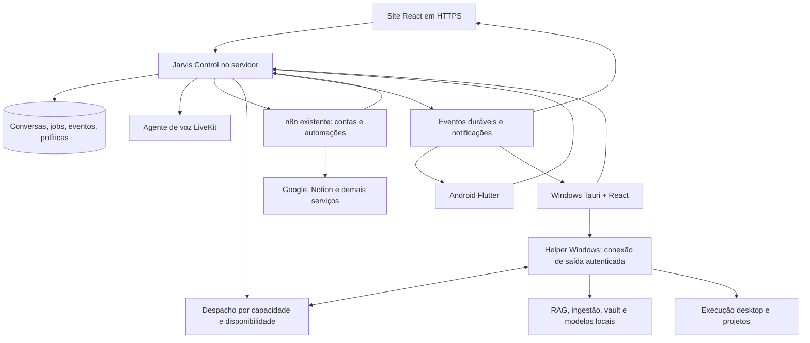

# Plano de evolução do Jarvis — 27/10/2026

**Estado atualizado:** consulte [ENTREGA.md](ENTREGA.md) para código, artefatos, testes e pendências desta implementação. Este documento registra o plano original.

**Estado: planejamento, com inspeção do código local e das fontes públicas.** Nenhuma alteração no servidor, nas contas, no helper ou nos aplicativos foi executada nesta etapa. Os APKs e o instalador descritos abaixo são entregas futuras. A autorização atual do usuário é planejar a evolução completa e preparar a implantação por scripts executados por ele.

## 1. Decisão principal

Manter a UI React como uma aplicação web e entregá-la também em **Tauri 2 para Windows**, completando a base existente. O servidor Linux continua sendo o núcleo de controle. O PC passa a ser um executor disponível somente enquanto o programa estiver em execução; RAG, documentos, modelos locais e ferramentas de Windows continuam nele. O aplicativo Flutter existente continua sendo o cliente Android.

Não substituir os três projetos atuais por um dos templates. Aproveitar os componentes visuais e os padrões de funcionalidade, adaptando os contratos para o Jarvis já instalado.

Documentos complementares:

- [Guia de contas e diagnóstico de Google/Notion](CONTAS.md).
- [Inventário completo das 75 integrações e seus requisitos](CATALOGO.md).
- [Manifestos públicos, revisão e hashes de origem](catalogo-n8n-claw.json).
- [Plano de scripts, publicação e reversão](IMPLANTACAO.md).

## 2. O que foi efetivamente encontrado

| Área | Evidência local | Implicação |
| --- | --- | --- |
| Interface atual | `src/App.tsx`, React 19, Vite, Projects/Contexto/RAG/Ingestão/Relatórios | Reaproveitar telas e estado; trocar a estrutura visual gradualmente |
| Windows | `src-tauri/src/main.rs` só inicializa Tauri; `bundle.active=false` | Ainda não existe instalador operacional com ponte local |
| Pontes | `services/*-bridge.mjs`, `jarvis-request.py`, middlewares de Vite | Build estático não fornece essas APIs; precisam de serviço de produção |
| Backend real | `C:\J.A.R.V.I.S\jarvis\src`, incluindo `jarvis_control`, `jarvis_desktop`, `personal_data.py` | Este é o backend a evoluir; os templates não são a instalação real |
| Android real | `C:\J.A.R.V.I.S\jarvis\livekit_flutter_starter-main` | Flutter 1.7.0+26 no fonte; confirmar versão instalada de cada aparelho na etapa de atualização |
| Atualizações móveis | `master/event_stream.dart`, `event_store.dart`, telas de relatórios/projetos/conexões | Já existe WebSocket com cursor; ampliar entrega e recuperação em vez de duplicar o sistema |
| Assinatura Android | `android/app/build.gradle`: release usa chave de debug | Antes de qualquer atualização, comparar certificado e applicationId dos APKs instalados; trocar chave rompe atualização direta |
| Contas | `personal.py`, `integrations.py`, `deploy/n8n/build.py` | Google A/B, Outlook e Notion já têm gateway e verificação; investigar a implantação real |
| Notion | Header `2022-06-28`, busca `object=database`, consulta `databases/{id}/query` | Avaliar migração para data sources e leitura de páginas/blocos |
| n8n existente | `deploy/personal-integrations/compose.yaml`, porta local 5679, imagem com digest | Preservar instância, credenciais, banco e chave de criptografia |
| Histórico | `docs/continuidade-jarvis-integracoes-pessoais.md` registra pendências em 24/10 | Não prova que continuam pendentes hoje; o usuário informa contas já autorizadas |
| Inicialização do PC | README documenta helper no login; CLI tem `uninstall-startup` | Mudar esse comportamento para cumprir “só quando inicio o programa” |
| Documentação | README contém descrições contraditórias sobre relatórios implementados versus planejados | Atualizar documentação a partir de evidência na primeira fase |

**Não houve acesso SSH nesta análise.** Release ativa, capacidade do servidor, estado dos tokens, conectividade externa e versões instaladas nos telefones continuam a confirmar. Não diagnosticar falha de OAuth só pelo documento antigo.

## 3. Como usar cada template

### JARVIS-ui: linguagem visual

A cópia `TemplatesIA/JARVIS-ui/JARVIS-main` está incompleta: há README e poucos arquivos Python; faltam `web/`, `electron/`, configuração e módulos importados por `jarvis/main.py`. Não é possível simplesmente executar a interface dessa cópia.

Há, entretanto, uma implementação de HUD em `TemplatesIA/Jarvis-main/web/src`: `Orb`, `Atmosphere`, `BootSequence`, `Subsystems`, `PlanPanel`, `SwarmPanel`, `TerminalPanel`, `MediaHub` e `CommandBar`. A imagem `TemplatesIA/Jarvis-main/docs/images/hud-wide.png` foi inspecionada e corresponde à direção desejada: fundo escuro, ciano, núcleo circular e painéis laterais. Usar esses arquivos como referência complementar disponível. A pasta `Jarvis-main` também contém outra UI em `jarvis/ui/jarvis-ui`; escolher uma referência por componente, sem unir os dois aplicativos.

Reimplementar os componentes na UI atual ou portar módulos isolados. A referência usa React 18/Fiber 8; o projeto atual usa React 19. Resolver compatibilidade das bibliotecas 3D em um protótipo pequeno antes de importar dependências; não substituir o lockfile do projeto pelo do template.

### n8n-claw: automações e conectores no servidor

Reaproveitar os conceitos e adaptar os workflows de lembretes, tarefas, verificações periódicas, erros, memória, arquivos, e-mail e catálogo de integrações. O `mcp-library-manager.json` fixa o catálogo em `fb71ed4`; a revisão completa foi resolvida e seus **75 manifestos** foram inventariados.

Não rodar `setup.sh` do template sobre a produção: o compose dele cria outra instância n8n, usa `latest`, outro banco e outra topologia. Primeiro importar workflows adaptados na instância existente com prefixo `Jarvis v2 /`, desativados, e credenciais referenciadas por identificadores reais.

O template guarda segredos de skills em `template_credentials` sem criptografia e compartilha Google em `google-oauth`. A adaptação usará credenciais criptografadas do n8n, referências no catálogo e isolamento por proprietário/conta/serviço. Instalar uma skill não concede acesso automático a todas as suas ferramentas. A chave administrativa do n8n não fica disponível ao agente de conversa.

Os fluxos que usam Supabase/PostgREST serão adaptados para operações autenticadas do `jarvis-control`. Manter SQLite como registro central inicial de jobs/eventos/aprovações; não criar uma segunda verdade para esses dados. PostgreSQL/pgvector entra somente se medições de memória e concorrência justificarem, em serviço e schema próprios, com migração separada. Registrar dependências de cada workflow; não importar JSON dependente de tabelas ausentes.

### Jarvis-main: capacidades complementares

| Capacidade de referência | Adaptação ao Jarvis |
| --- | --- |
| Chat/voz e estados da esfera | Eventos reais do LiveKit e do backend existente, português brasileiro |
| Briefing matinal e preparação de reuniões | Rotinas no servidor consultando contas verificadas; resultados no Android/web |
| Memória, histórico e sessões retomáveis | Persistência no servidor, proveniência, expiração e opção de apagar |
| Plano, execução e revisão | Aproveitar plano com hash/versão e aprovação já existentes |
| Roteamento entre modelos | Política no servidor, limites e disponibilidade; modelo local exige PC ativo |
| Controle de navegador | Worker isolado no servidor para sites; helper no PC para navegador local |
| Arquivos, OCR, visão e captura de tela | Capacidades explícitas do helper; tela/câmera só em sessão habilitada |
| Skills/MCP | Registro revisado, contrato estável, execução autorizada a cada chamada |
| Custos e telemetria | Medição por execução; quando não houver medição, mostrar indisponível |
| Mídia e 3D | Etapa avançada no PC, conforme VRAM/RAM medidas e modelos disponíveis |
| Overlay, wake word e áudio por dispositivo | Windows/Tauri e Flutter; preservar LiveKit como caminho funcional inicial |
| Ferramentas exclusivas do Mac | Substituir Keychain/AppleScript/Swift/MLX/Apple Notes por equivalentes compatíveis; iMessage não vira recurso Windows por copiar o template |

Manter atribuição e licenças dos componentes efetivamente reutilizados. Os dois templates Jarvis têm LICENSE MIT; verificar licença/proveniência de cada workflow, asset e catálogo antes de redistribuir. Nomes de modelos, contagens de ferramentas e promessas de desempenho dos READMEs não são critérios de compatibilidade.

## 4. Arquitetura proposta

O servidor coordena; provedores externos continuam sendo externos. Hospedar a coordenação no Linux não significa que consultas a Google, modelos de nuvem ou serviços do catálogo deixem de sair da infraestrutura. Cada conexão indicará destino e tipo de dado transmitido. O RAG técnico continua local; sincronizar apenas relatórios e trechos necessários à tarefa autorizada.

### Separação de responsabilidades

| Servidor sempre ligado | PC enquanto o programa roda | Celular |
| --- | --- | --- |
| Identidade, permissões e revogação | RAG C#, documentação e vault | Voz, chat e visualização |
| Contas/OAuth e workflows n8n | AirLLM/Ollama conforme instalação real | Notificações e histórico |
| Conversas, tarefas, memória pessoal | Ingestão e diagnósticos do projeto | Aprovar/rejeitar/cancelar conforme papel |
| Agendamentos e notificações | Ferramentas Windows e execução em cópias | Verificação de conexões e recursos autorizados |
| Política de modelos e auditoria | GPU/CPU e modelos pesados | Não depende de USB para conversar com servidor |

Com PC desligado, agenda, e-mail, Notion, automações do servidor e histórico continuam disponíveis. RAG local, geração local e edição do projeto mostram **PC indisponível**. Não substituir uma consulta RAG atual por conteúdo antigo sem indicar data e origem. Não iniciar posteriormente uma tarefa desktop recusada por estar offline; preservar a regra atual. Agendamento explícito pode escolher “pular” ou “aguardar até prazo”, com essa escolha registrada pelo usuário.

## 5. Interface web e Windows

### Telas

1. **Central Jarvis:** esfera/reator, texto/voz, últimas atividades, tarefas em andamento e disponibilidade separada de servidor/PC/contas.
2. **Projetos:** conversas atuais, planos, diff/evidências, aprovação, cancelamento e progresso. Manter IDs e histórico existentes.
3. **Conhecimento:** RAG local, contexto, fontes e ingestão; resultados com hash/data/origem.
4. **Contas:** catálogo, conta/serviços, conexão, identidade mascarada, última consulta real, erro e caminho de correção.
5. **Rotinas:** briefing, lembretes, monitoramentos, histórico de disparos e próximas execuções no fuso de São Paulo.
6. **Atualizações:** relatórios e eventos, filtros, leitura/entrega, erros e decisões pendentes.
7. **Sistema:** serviços, modelos, CPU/GPU/RAM reais, armazenamento e configurações.

HUD com núcleo central e conversa lateral no monitor; no modo trabalho, reduzir animação e priorizar texto/projetos. Em telas pequenas, cartões em coluna. Navegação por teclado, foco visível, contraste, `prefers-reduced-motion`, opção de efeitos mínimos e fallback 2D. Não reproduzir números de telemetria da screenshot como dados reais.

Esfera com estados `offline`, `idle`, `listening`, `thinking`, `speaking`, `waiting_approval`, `error`. Apenas amplitude de áudio real anima a fala. Inicialização mostra etapas verificadas; sequência cinematográfica é curta, desativável e não atrasa funções prontas. Mídia pesada carregada sob demanda.

### Entrega técnica

Extrair transporte para uma interface comum de cliente. Web remoto usa API do servidor e sessão autenticada com cookie HttpOnly/Secure, proteção CSRF, origem validada e autorização por rota; não recebe a credencial DPAPI do PC. Tauri usa IPC tipado para o serviço/helper local. Site local pode usar serviço loopback com autenticação efêmera e origem exata. Não expor a API local na rede.

Mover endpoints hoje exclusivos do Vite para serviço de produção. A UI remota solicita RAG/desktop pelo servidor; não tenta abrir `localhost` do aparelho visitante. CSP e permissões Tauri devem contemplar apenas IPC, destinos HTTPS/WSS necessários e mídia autorizada, sem acesso irrestrito ao shell. [Referência de sidecars Tauri](https://v2.tauri.app/develop/sidecar/).

Empacotar UI estática e launcher/ponte; gerenciar ambientes Python e modelos existentes, sem colocar pesos de vários GB no instalador. Dependências ausentes precisam de diagnóstico e instalação explícita. Validar em instalação Windows sem Vite/Node de desenvolvimento rodando.

### Ciclo de vida do PC

- Uma instância do app possui uma sessão de execução e inicia helper/RAG/ingestão/diagnósticos quando necessários.
- Ao migrar, remover somente a entrada conhecida de autostart do helper, com backup e reversão. Não alterar outros programas de inicialização.
- Fechar o app encerra a sessão e os processos pertencentes a ela. Se houver job ativo, apresentar “aguardar término” ou “cancelar e sair”; não deixar execução escondida por padrão.
- Minimizar mantém o programa aberto e indica isso. “Sair” encerra de fato. Modo bandeja é opcional e visível.
- Lease/heartbeat com TTL no servidor evita considerar um PC conectado depois de crash/suspensão. Reinício do PC não retoma execução de escrita automaticamente.
- Serviços com instância compartilhada/referência externa não são mortos só porque a janela fecha; registrar propriedade dos processos e resolver o modelo de compartilhamento na fase 2.

## 6. n8n e todas as integrações

Entregar catálogo de todas as 75 entradas da revisão fixada, mais os canais do template: Telegram, Slack, Teams, Discord, webhook genérico/Paperclip e adaptação WhatsApp. Outlook existente também continua. **Disponível no catálogo**, **instalado**, **configurado**, **autorizado**, **verificado** e **habilitado para o aparelho** são estados diferentes.

Não é necessário ter conta em todos os serviços para entregar a infraestrutura de conexão. Cada conector sem credencial fica aguardando configuração; os testes reais correspondentes ficam pendentes, sem exibir sucesso fictício. A expansão futura do catálogo passa por atualização de revisão e revisão das mudanças, não por seguir `master` automaticamente.

Contrato de execução proposto: `connection_id`, `service`, `operation`, `arguments`, `request_id`, `deadline`; usuário/aparelho vêm da sessão autenticada. Retorno: `schema_version`, `items`, `sources`, `queried_at`, `partial`, `errors`, `next_cursor`, `trace_id`. Preservar contratos atuais das seis ferramentas pessoais durante migração.

Registro por conexão com provedor, conta lógica, referência de credencial, escopos concedidos, recursos autorizados, serviços verificados, última falha, expiração conhecida e permissões de ação. Operações de leitura e escrita possuem políticas diferentes. Enviar mensagem, publicar, apagar, comprar ou mudar recurso requer prévia concreta e a autorização aplicável; aprovação vincula usuário, alvo, argumentos, hash e prazo. Repetir request não duplica efeito.

Workflows chamam gateway autorizado; não executar comando arbitrário recebido de e-mail, documento ou resposta de ferramenta. Credenciais nunca entram em prompts, frontend, telemetria ou catálogo exportado. Downloads e browser isolados precisam de limites e proteção contra SSRF, redirecionamentos para rede interna e arquivos excessivos. Destinos locais necessários são cadastrados por administrador, não fornecidos livremente pelo modelo.

MCP Builder, WorkflowBuilder e instalação de ferramentas podem gerar **rascunhos** revisáveis. Publicação e concessão de acesso administrativo ficam em operação própria. Open Terminal/OpenClaw não recebem shell root no servidor principal. Meta Ads/TikTok no catálogo usam Pipeboard, um intermediário externo: oferecer adaptação à API direta ou declarar essa dependência, sem descrevê-los como totalmente auto-hospedados.

### Automações a portar

| Família | Comportamento final |
| --- | --- |
| Heartbeat | Executar rotinas vencidas uma vez, com lock, fuso, política para atrasos e limites |
| Lembretes | Persistência, cancelamento, repetição e entrega ao Android/web |
| Background Checker | Notificar só mudança relevante; deduplicação e registro de última checagem |
| Error Notification | Erro com ação sugerida, trace ID e resumo sem segredos |
| Memory Consolidation | Somente fontes autorizadas; retenção e opção de apagar; sem depender do PC |
| Project Memory | Notas pessoais no servidor; código/vault local continuam no PC |
| File/Email Bridge | Serviço interno opcional, retenção/limites/TLS, sem portas públicas desnecessárias |
| Browser/SearXNG/Crawl4AI | Perfis opcionais após medir capacidade; browser sem credenciais administrativas do host |
| Expert agents | Delegação por tarefa dentro do produto, reaproveitando executor e orçamento; sem iniciar outro núcleo autônomo |

## 7. Diagnóstico e correção de Google/Notion

Investigar na ordem: release ativa → serviço/gateway → workflow/credencial → provedor → normalização → permissão da sessão → ferramenta de texto/voz. O [guia de contas](CONTAS.md) detalha comandos e testes.

Hipóteses sustentadas pelo código, ainda não confirmadas na produção:

- Runtime pessoal desligado, versão antiga ou configuração de gateway ausente.
- Credencial conectada, mas workflow sem referência correta, inativo ou escopo insuficiente.
- Google A/B trocados, Gmail habilitado na conta sem esse escopo, API desabilitada, refresh token expirado ou `identity_changed`.
- Verificador marca toda a conta em erro quando um dos serviços falha; evoluir para estado por serviço e resultado parcial, sem liberar serviço não verificado.
- Notion conectado ao workspace, porém base original não compartilhada; página comum/checklist não aparece como database.
- API antiga em base com múltiplas fontes; migrar discovery, parser, allowlist e testes juntos. Só mudar o header pode quebrar o fluxo. [Guia oficial de data sources](https://developers.notion.com/guides/get-started/upgrade-guide-2025-09-03).
- Aparelho sem `personal-access`; hoje o gateway exige aparelho do tipo `app`, então o desktop também precisa de caminho autorizado próprio, sem fingir ser telefone.

Aceite: ler um evento conhecido, um arquivo conhecido, uma mensagem conhecida e uma tarefa/página conhecida, preservando conta/origem. OAuth válido ou HTTP 200 com lista vazia não comprovam acesso aos dados pretendidos. Testar renovação e revogação, não somente o primeiro login.

## 8. Android principal e S23

Manter um código Flutter e os papéis definidos no servidor. No contexto existente, Motorola é o aparelho principal e Samsung S23 FE é companion; confirmar essa associação pelos cadastros e artefatos antes de publicar. Não promover S23 a master, nem liberar mensagens pessoais pelo perfil `work_access`.

Central de atualizações com progresso, plano aguardando decisão, conclusão, relatório, erro de rotina e conta expirada. Cada evento tem ID, sequência, execução, dispositivo destinatário, data, severidade e estado de leitura. Persistir antes de enviar; replay por cursor, ACK e deduplicação. Compactar progresso frequente e preservar marcos/finais. Se o cursor expirar, buscar snapshot e informar lacuna.

WebSocket para app aberto, reconexão com backoff e recuperação ao retomar. Para app suspenso, propor FCM como transporte de aviso mínimo (ID opaco), com dados buscados no servidor após autenticação. Isso exige configurar Firebase e não transfere o controle do Jarvis. Alternativa totalmente auto-hospedada: transporte persistente/ntfy próprio, sujeito às restrições de bateria do Android e sem promessa de entrega instantânea em Doze. A escolha do transporte será configurável; não depender apenas de polling WorkManager para alertas imediatos. [Prioridade FCM](https://firebase.google.com/docs/cloud-messaging/android-message-priority).

Permissão de notificações, canais por tipo, silêncio, áudio escolhido por aparelho e ocultação de conteúdo na tela bloqueada. Abrir a notificação leva ao job/relatório correto; ações só executam depois de validar sessão e versão do plano. Não contornar Não Perturbe. [Permissão Android](https://developer.android.com/develop/ui/views/notifications/notification-permission).

“Atualizações pelo app” contempla progresso do Jarvis e uma área de versões do software. Atualização de APK exige pacote assinado compatível, hash, changelog, canal correto e confirmação do instalador Android; não haverá instalação silenciosa. API mantém compatibilidade com app antigo enquanto S23 estiver desconectado.

Entregas futuras: APK principal atualizado e APK companion S23 em pasta local, manifestos com versão/hash/certificado e instruções. **S23: compilar e testar sem USB; não enviar ao aparelho nem publicar seu APK no servidor/canal de atualização agora.** Instalação e teste real em aparelho bloqueado ficam registrados como pendentes até ele voltar.

## 9. Etapas e critérios de saída

| Etapa | Trabalho | Critério de aceite | Faixa de esforço |
| --- | --- | --- | --- |
| 0 — Baseline | Inventário real, backup, contratos, versões, assinatura Android, documentação | Relatório sem segredos; restauração comprovada; versão ativa identificada | 1–2 dias |
| 1 — UI primeiro | HUD, navegação e adaptação das telas atuais | UI ligada aos dados existentes; layout responsivo e efeitos reduzidos; sem regressão de Projects | 3–5 dias |
| 2 — Windows | Ponte de produção, Tauri, ciclo de vida e instalador | Funciona sem Vite; ligar/desligar acompanha app; PC offline detectado | 3–5 dias |
| 3 — Contas atuais | Diagnóstico Google/Notion, correções, permissão por serviço | Quatro consultas reais, múltiplas contas, renovação, revogação e PC desligado | 2–4 dias |
| 4 — n8n base | Catálogo, adaptadores, estados, segredos, rotinas e eventos | Imports repetíveis, rotinas sem duplicação e notificações recuperáveis | 4–7 dias |
| 5 — Android | Central de atualizações, transporte, conexões, dois artefatos | Principal validado quando disponível; S23 compilado e guardado sem distribuição | 3–5 dias |
| 6 — Catálogo completo | Adaptar/revisar os 75 conectores em lotes, canais e testes de contrato | Todos catalogados; cada conector implementado com estado honesto; testes reais nos autorizados | 10–20 dias |
| 7 — Complementos | Memória, browser, voz local opcional, mídia e 3D | Cada recurso medido e isolado; indisponibilidade local explícita | 5–10 dias |
| 8 — Fechamento | Testes integrados, restauração, documentação e releases | Matriz abaixo satisfeita ou pendência externa explicitamente registrada | 2–4 dias |

Faixas são estimativas de engenharia, não prazo fechado: primeira versão útil (UI/Windows/contas atuais) em aproximadamente 9–16 dias de trabalho; escopo completo em 33–62 dias, sujeito a APIs, hardware e autorizações. Não somar espera por consentimento dos provedores como trabalho concluído. A prioridade visual solicitada vem antes das expansões do catálogo; inventário e backup precedem qualquer publicação.

Lotes do catálogo: A) Google/Notion/Outlook; B) arquivos/tarefas/conhecimento; C) comunicação/canais; D) fontes públicas; E) CRM/marketing/comércio e serviços específicos; F) execução/mídia e recursos com infraestrutura extra. Todas as 75 entradas permanecem no escopo, com bloqueios individuais rastreáveis.

## 10. Validação final

- Servidor atende contas, rotinas, voz e histórico com o PC desligado; recursos locais ficam indisponíveis corretamente.
- Abrir/fechar app Windows inicia/encerra os processos de sua sessão; crash e suspensão expiram disponibilidade.
- Site remoto funciona sem ponte Vite e sem credenciais do helper no navegador.
- Google A/B, Notion e Outlook retornam dados conhecidos; uma falha não mistura contas nem libera serviço sem autorização.
- Conteúdo de documentos não altera políticas do agente; permissão revogada vale na chamada seguinte.
- Workflow repetido e callback duplicado não duplicam publicação, envio ou tarefa.
- Reiniciar n8n/backend preserva credenciais e dados; backup criptografado é restaurado em destino isolado.
- Android recupera eventos depois de queda, não repete anúncio final, abre a execução correta e respeita permissão/Não Perturbe.
- S23 antigo continua compatível; APK novo preserva assinatura/pareamento e permanece local nesta entrega.
- Testes de UI, contratos de gateway e helper, migrações e Flutter; regressão dos serviços locais quando alterados.
- Mudança de comportamento de voz exige cenário antes da implementação, simulação e debugger, conforme `C:\J.A.R.V.I.S\jarvis\AGENTS.md`. Testes impedidos por cota ficam pendentes, não aprovados.

O histórico de testes antigos serve como referência, não como aprovação desta futura release. Executar os checks pertinentes sobre o conteúdo exato de cada pacote.

## 11. Informações que só serão necessárias na execução

Apelidos das contas e Gmail escolhido, bases/páginas do Notion, serviços adicionais realmente utilizados, capacidade livre do servidor/GPU local, endereço HTTPS ou VPN já usado pelos celulares, opção de push, certificado Android e credenciais de assinatura disponíveis. Usar os cadastros e arquivos existentes antes de pedir dados novamente. Nenhuma senha deve ser enviada pelo chat; OAuth acontece no navegador e senha SSH/sudo no terminal aberto pelo usuário.
