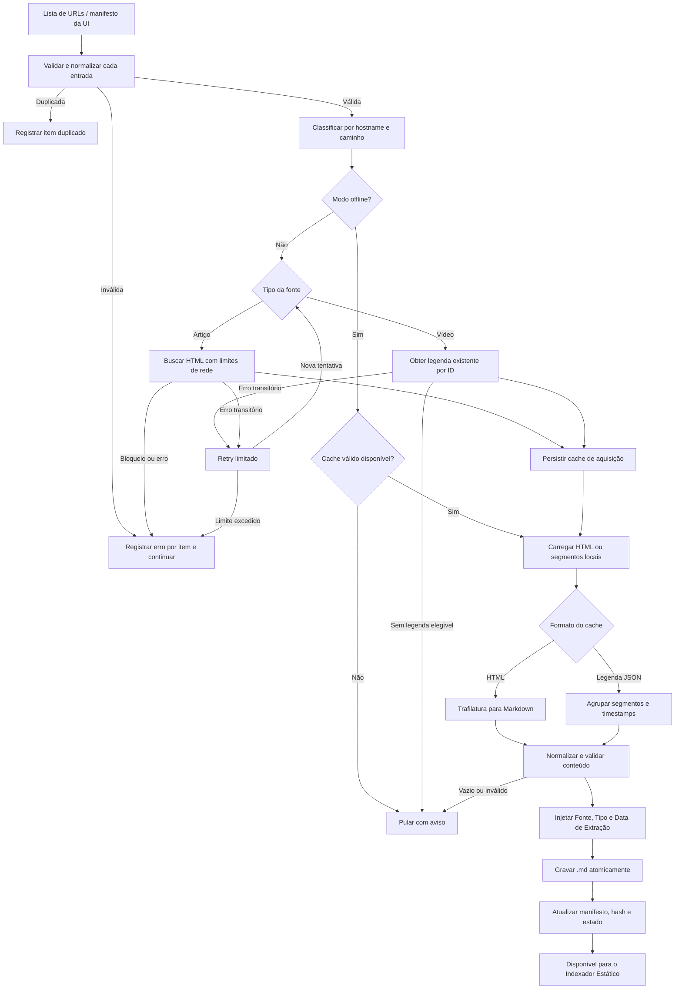

# Pipeline de ingestão para o RAG — arquitetura e plano

Data da revisão: 21/10/2026. Versão do plano: 2. Entrega atual: UI de preparação implementada; coleta Python não implementada. Complementa o [plano do RAG dinâmico](plano-rag-dinamico-airllm-claude.md), especialmente seu Módulo 2.

> **Atualização 21/10/2026 — implementado** em `services/ingestion` (`rag_ingestion`), com API em 127.0.0.1:8766 e botões de coleta/indexação na UI. Primeira coleta real do catálogo: 12/12 documentos em `documentacao_rag/`. Ver [services/ingestion/README.md](../services/ingestion/README.md).

## 0. Instrução de passagem para o Claude

Este arquivo especifica aquisição, cache, manifesto de entrada e Markdown. O plano RAG define ambiente compartilhado, indexação, consulta, inferência e a ordem conjunta de execução (seção 12). Ler ambos antes de implementar. Esta revisão altera somente os documentos; implementar os serviços quando o usuário solicitar a execução ao Claude.

Estado confirmado no workspace: a UI exporta rascunhos, mas não existem `services/ingestion/`, `services/rag/` ou `documentacao_rag/`. `services/context-reader.mjs` lê notas locais e não é o indexador Chroma. Ter a biblioteca AirLLM baixada não torna o RAG operacional. Não interpretar o futuro desenhado neste documento como funcionalidade já instalada.

Critério de integração: ingestão escreve Markdown concluído; o serviço RAG é o único dono do Chroma; a UI pede indexação explicitamente e distingue coleta concluída, índice pronto e geração disponível. Não acoplar o extrator ao carregamento do modelo.

## 1. Objetivo e fronteira offline

Transformar uma lista explícita de URLs de documentação, fóruns e vídeos em arquivos Markdown rastreáveis, armazenados no computador e prontos para o indexador estático. Nenhum conteúdo precisa ser enviado a um LLM para extrair, limpar ou formatar os documentos.

Uma URL remota não pode ser baixada sem acesso à rede. Portanto, dividir o funcionamento em etapas com capacidades explícitas:

| Fase | Rede | Resultado |
| --- | --- | --- |
| Preparação | Não | Validação sintática, classificação e lote de fontes |
| Aquisição | Sim, para os sites e YouTube | HTML e legendas existentes em cache local |
| Extração a partir do cache | Não | Markdown padronizado |
| Indexação e consulta RAG | Não, com dependências e modelos já instalados | Chroma local e inferência AirLLM |

O modo `offline` deve proibir qualquer aquisição externa, inclusive fallback, redirecionamentos e verificação de atualização. O núcleo não abre sockets; a UI pode conversar com o serviço em loopback. Sem cache, retornar `skipped / offline_cache_miss`. Instalação inicial de dependências/modelos também exige preparação anterior ou artefatos disponíveis localmente.

Usar exclusivamente Trafilatura para extração de sites e youtube-transcript-api para obtenção de legendas. Biblioteca padrão Python pode cuidar de URLs, transporte controlado, arquivos, logs, filas e SQLite. Não adicionar Whisper, download de áudio, tradução automática, navegador headless, extração por LLM, scraping alternativo ou serviços hospedados.

## 2. O que já funciona na UI

Acessar `/#ingestion` ou o menu **Ingestão de fontes**.

- Inserir URLs, uma por linha, ou carregar lista `.txt` UTF-8.
- Identificar artigos e links de vídeo, incluindo watch, youtu.be, shorts, embed e live.
- Validar HTTP(S), rejeitar credenciais embutidas, endereços locais evidentes, playlists sem vídeo e identificadores malformados.
- Deduplicar vídeos por ID e artigos por URL normalizada sem fragmento, preservando query strings e a URL original.
- Manter até 200 fontes no armazenamento do navegador, com aviso em caso de falha de persistência.
- Filtrar, buscar, selecionar, remover e inspecionar o formato previsto de saída.
- Exportar URLs `.txt` e manifesto JSON com `collection_executed: false`.

A UI não testa se uma página existe, se o YouTube possui legendas ou se o destino permite escrita. Não faz requests às fontes, não cria `documentacao_rag/` e não declara arquivos extraídos/indexados. A prévia contém placeholders e não recebe uma data de extração fictícia. O destino indicado é planejamento; a exportação usa o download padrão do navegador.

Código atual: `src/IngestionPanel.tsx`, `src/ingestion.ts`, `src/ingestion.css`, integração em `src/App.tsx` e `src/domain.ts`.

## 3. Fluxo lógico proposto



O orquestrador processa cada item isoladamente. Sucesso de um item independe dos demais. Começar sequencialmente, com pausa por domínio, para facilitar depuração e reduzir bloqueios. Concorrência limitada pode ser adicionada após validar o fluxo; não criar agentes de IA para esta função.

## 4. Organização Python planejada

```text
services/ingestion/
  pyproject.toml
  requirements.lock.txt           # gerado após resolver e testar dependências
  config.example.toml
  README.md
  src/rag_ingestion/
    __init__.py
    __main__.py                   # CLI e parsing dos argumentos
    config.py                     # modo, diretórios, timeouts e limites
    models.py                     # dataclasses/Enums dos contratos
    urls.py                       # validação, normalização e classificação
    acquisition.py                # transporte/cache e orçamento de rede
    web_extractor.py               # Trafilatura
    youtube_extractor.py           # youtube-transcript-api
    formatter.py                   # corpo Markdown e cabeçalho
    storage.py                     # caminhos, hash e escrita atômica
    repository.py                  # SQLite: lotes, itens e tentativas
    pipeline.py                    # sequência, retries e isolamento de falhas
    events.py                      # logs estruturados e progresso
  tests/
    fixtures/                     # HTML/legendas sintéticos locais
    test_urls.py
    test_extractors.py
    test_pipeline.py
    test_storage.py
documentacao_rag/                  # apenas .md concluídos; destino configurável
  artigo-<source_id>.md
  video-<video_id>.md
.local/ingestion/
  state.sqlite3
  cache/<source_id>/<revision>/    # HTML ou JSON + metadata/hash por aquisição
  manifests/<batch_id>.json
  logs/events.jsonl
```

Nenhuma pasta Python acima foi criada nesta etapa. O serviço futuro fica separado do AirLLM: não importa nem carrega o modelo para ingerir dados. A pasta final deve ser configurada como `docs_root` do Módulo 2. Cache, estado e logs ficam fora dela para não serem vetorizados.

Adicionar `api.py` ao pacote de ingestão para o serviço HTTP; o plano RAG define o ambiente único `.venv-rag` para ambos os pacotes, com resolução conjunta de dependências. O processo da ingestão não carrega bibliotecas/modelos de ML. Não usar o venv do Jarvis.

Configuração comum: `.local/ingestion.toml` com `project_id="dicevtt"`, `output_root="../documentacao_rag"`, `state_path="ingestion/state.sqlite3"` e `cache_root="ingestion/cache"`. Todos os relativos resolvem a partir do TOML. `.local/rag.toml` deve apontar `docs_root="../documentacao_rag"`. Comparar caminhos absolutos em `doctor`; nunca supor que CWD e diretório do TOML sejam iguais. Usar o mesmo `project_id` nos pedidos da UI e jobs de indexação.

O destino de coleta é dado local: acrescentar `documentacao_rag/` ao `.gitignore` ou documentar uma opção explícita de versionamento. A raiz de saída deve ser gravável e conter apenas documentos publicados pelo pipeline e documentos manuais permitidos; nenhum cache bruto entra no índice.

## 5. Entrada, identidade e classificação

Aceitar arquivo `.txt` de URLs ou manifesto JSON v1 exportado pela UI. O servidor deverá repetir toda a validação: não confiar em `kind`, `canonical_url` ou `video_id` enviados pelo cliente. Preservar a entrada original para o cabeçalho e rastreabilidade.

O contrato da UI está em `src/ingestion.ts:createManifest`. Exemplo estrutural (data apenas ilustrativa):

```json
{
  "schema_version": 1,
  "status": "draft",
  "collection_executed": false,
  "created_at": "2026-10-21T18:30:00.000Z",
  "output_directory": "documentacao_rag",
  "languages": ["pt-BR", "pt", "en"],
  "sources": [
    {
      "original_url": "https://docs.unity3d.com/Manual/",
      "canonical_url": "https://docs.unity3d.com/Manual/",
      "kind": "article"
    }
  ]
}
```

O manifesto atual não contém `project_id`; recebê-lo da configuração/rota. `output_directory` é uma indicação, não permissão de escrita em qualquer caminho. Para vídeo, a UI acrescenta `video_id`. UUIDs internos da lista do navegador não são IDs persistentes de fonte. Aceitar v1 sem exigir novos campos; migrações futuras devem manter um leitor v1. Rejeitar schema desconhecido e arrays fora do limite de 200 itens antes de agendar o lote; URLs inválidas dentro de lote estruturalmente válido viram falhas por item.

Revalidar também no Python os casos de `src/ingestion.ts`: URLs Unicode/IDNA, porta padrão, fragmentos, query strings, formatos YouTube e IDs. Criar fixtures compartilhados de entrada/resultado para evitar normalizações divergentes entre WHATWG URL no navegador e parsing Python.

Para artigos, normalizar esquema/host/porta padrão e remover fragmento; preservar caminho e query sem remover parâmetros arbitrariamente, pois podem identificar versões da documentação. Não fundir HTTP com HTTPS sem observar o redirecionamento. Guardar URL final separadamente. Não expandir recursivamente links, feeds ou sitemaps.

Para YouTube, usar allowlist exata de hosts e formatos suportados. Validar ID com 11 caracteres alfanuméricos, `_` ou `-`. Identidade canônica: `https://www.youtube.com/watch?v=<id>`. Uma URL watch com playlist pode ser reduzida ao vídeo individual; uma playlist sem ID de vídeo é rejeitada. Um domínio apenas contendo a palavra youtube não é classificado como YouTube.

`source_id` deve ser SHA-256 hexadecimal dos bytes UTF-8 de `canonical_url`, sem data, título ou UUID do lote. Para artigos, usar `artigo-<source_id>.md`; para vídeos, `video-<video_id>.md`. Não construir caminhos a partir do título remoto. Guardar a URL original no resultado de cada item, mesmo quando houver deduplicação. Deduplicação automática é por identidade canônica dentro do lote; conteúdo idêntico em URLs distintas pode ser sinalizado, mas não deve apagar a proveniência de uma delas.

O serviço de coleta aceitará somente destinos públicos. Revalidar DNS/IP e cada redirecionamento, bloqueando loopback, redes privadas, link-local, credenciais embutidas e esquemas não HTTP(S). Vincular a validação ao transporte para evitar troca de DNS entre checagem e conexão. A validação sintática do frontend não substitui essa proteção nem comprova acessibilidade.

## 6. Extração de sites

Separar aquisição HTTP de transformação. O transporte deve expor status, URL final, MIME, corpo e timestamps; não tratar todo retorno vazio como um mesmo erro. Aplicar timeout, limite de tamanho, limite de redirects e User-Agent identificável.

Passar HTML para `trafilatura.extract` com `output_format="markdown"`, `url` final, links e tabelas habilitados. Markdown é uma saída nativa documentada; não é necessário adicionar outro conversor. Comentários devem ser uma opção explícita para fóruns. Referência: [uso Python do Trafilatura](https://trafilatura.readthedocs.io/en/latest/usage-python.html).

Escolha inicial: excluir comentários para documentação; permitir `include_comments` por fonte de fórum. Preservar parágrafos, títulos, listas, tabelas e exemplos de código quando extraídos; testar essas estruturas com fixtures. Heurísticas de extração podem perder informações, portanto ausência de erro não comprova fidelidade integral.

Não executar JavaScript. Se o HTML só contiver um shell vazio, CAPTCHA ou login, registrar `content_unavailable`, sem salvar esse texto como documentação. Validar tamanho mínimo e sinais estruturais, com avisos de baixa qualidade quando apropriado. Esses validadores são heurísticos e devem constar no relatório.

Rejeitar PDFs, arquivos binários e outros formatos fora de escopo. Não renderizar HTML remoto diretamente na UI. Na futura prévia Markdown, sanitizar links/HTML e evitar carregamento automático de imagens remotas.

Em modo offline, chamar somente a transformação sobre HTML já salvo: não executar `fetch_url`, DNS, HEAD, robots ou outra verificação externa. No modo online, converter links que redirecionem para uma URL de vídeo suportada para o adaptador YouTube, reaplicando classificação/validação; não extrair o HTML do player como artigo. Qualquer redirecionamento não suportado termina com motivo claro.

## 7. Extração de YouTube

A API documentada usa uma instância `YouTubeTranscriptApi`, com `list(video_id)` e `fetch(video_id, languages=[...])`. Recebe o ID, não a URL. O retorno inclui segmentos com texto/início/duração, idioma e informação sobre legenda automática. Referência: [youtube-transcript-api](https://github.com/jdepoix/youtube-transcript-api).

Política do projeto: priorizar `pt-BR`, depois `pt`, depois `en`. Para cada idioma, preferir legenda manual e depois legenda automática já disponibilizada pelo YouTube. Iterar idioma por idioma para assegurar que uma legenda manual em inglês não ultrapasse uma automática em português. Registrar idioma/tipo efetivamente selecionados. Não chamar tradução e não produzir áudio/transcrição própria.

`list(video_id)` também acessa rede; seleção de legenda pertence à aquisição, não à etapa offline. Cachear a legenda selecionada como JSON serializável com `schema_version`, source_id, video_id, language_code, is_generated, acquired_at e segmentos `{text, start, duration}`. Não persistir objetos de biblioteca ou pickles. Em offline, carregar esse JSON validado e pular a construção de clientes/sessões de rede.

Sem legenda em idioma elegível: `skipped` com motivo específico (`no_captions`, `captions_disabled` ou `language_unavailable`). Um bloqueio de acesso não equivale a ausência de legendas. Mapear exceções da versão instalada em códigos estáveis do domínio.

Agrupar segmentos em parágrafos, preservando ordem e timestamps de referência. Normalizar espaços sem retirar repetições legítimas ou termos técnicos. Para reduzir redundância de legendas sobrepostas, usar somente regra determinística conservadora e testada. Registrar no Markdown “Legenda automática” quando aplicável. Se o título não estiver disponível pela ferramenta exigida, usar `Vídeo <id>`; não introduzir outra API apenas para obter título.

## 8. Padronização e armazenamento

Cabeçalho obrigatório, em texto Markdown legível, sempre no topo:

```text
Fonte: https://URL-ORIGINAL
Tipo: Artigo
Data de Extração: 2026-10-21T15:30:00-03:00

---

# Título extraído ou título de fallback

Conteúdo limpo...
```

A data acima é apenas exemplo. Em produção, usar timestamp real com offset ISO 8601; exibir na UI em America/Sao_Paulo. Vídeos usam exatamente `Tipo: Vídeo`. Rejeitar quebras de linha nos metadados e escapar conteúdo quando necessário. O cabeçalho começa no byte inicial (aceitar BOM na leitura) e termina no primeiro `---` isolado. Linhas são `Nome: valor`, divididas apenas no primeiro `:`, pois URLs e datas contêm dois-pontos.

Além das três primeiras linhas obrigatórias, o pipeline deve emitir, antes do delimitador, `Source ID`, `URL Canônica` e `Aquisição Original`; emitir `URL Final` quando houver redirect e `Idioma`/`Legenda` para vídeo. `Legenda` é `manual` ou `automática`. O indexador deve aceitar também documentos com somente o cabeçalho mínimo e arquivos manuais sem cabeçalho. Não usar frontmatter YAML incompatível nem exigir sidecar para recuperar a Fonte.

Mapeamento para o Módulo 2: `Fonte` → `source_url`; `Tipo` → `source_type=article|video`; `Data de Extração` → `extracted_at`; `Source ID` → `ingestion_source_id`; `URL Canônica` → `canonical_url`; `Aquisição Original` → `acquired_at`; `Idioma` → `language`. O tipo vetorial sempre é `kind=documentation`, independentemente de artigo/vídeo. Copiar metadata para cada chunk, sem repetir o cabeçalho obrigatório no embedding. Registrar esquema de formato no manifesto e validar o round-trip escritor → parser nos testes.

Salvar UTF-8 com LF. Normalizar espaços/quebras sem alterar indentação dos blocos de código, tabelas ou significado. Hash do corpo sem cabeçalho serve à deduplicação de conteúdo; hash do arquivo completo serve ao controle de versão do indexador.

Escrever arquivo temporário no mesmo filesystem, flush/close e substituição atômica. O indexador só recebe caminho final depois da conclusão. Em nova coleta, manter versão anterior até sucesso da substituição. Não substituir documento válido por arquivo vazio, erro HTTP ou conteúdo parcial.

Ingestão e RAG usam processos/bancos distintos; não há transação distribuída entre arquivo, SQLite da ingestão e Chroma. Registrar operação `writing` com destino/hash esperado antes da publicação; publicar `.md`; confirmar `completed` no SQLite. Ao reiniciar, reconciliar `writing` pelo hash do arquivo final e pelo temporário, sem presumir sucesso nem apagar versão boa. Manifesto JSON é exportação do estado SQLite, não uma terceira fonte de verdade. Uma falha de exportação do relatório não invalida um `.md` já confirmado; registrar aviso.

Cache bruto é versionado e verificado por hash, com aquisição finalizada antes de ser elegível ao modo offline. Configuração deve prever limite de disco e limpeza explícita de revisões antigas; nunca limpar automaticamente o documento final por expiração de cache. Preservar metadata da aquisição mesmo se o corpo bruto for removido. Reprocessar o mesmo cache com as mesmas opções pode ser no-op e preservar data/hash do documento; regeneração explícita registra nova extração. Uma coleta nova que falha preserva o documento anterior e registra o erro da tentativa separadamente.

Manifesto de execução registra fonte original/canônica/final, status, motivo, hash, caminho relativo, ferramenta/versão, idioma, tempo, origem do cache e timestamps de aquisição/extração. Se regenerado offline, manter `acquired_at` anterior e registrar nova `extracted_at`; no-op preserva ambas as datas do documento existente. Não insinuar que a fonte remota foi atualizada.

## 9. Tratamento de erros

| Condição | Estado / motivo | Ação |
| --- | --- | --- |
| URL inválida, protocolo indevido ou credenciais | `failed / invalid_url` | Não acessar rede; registrar item e continuar |
| Link repetido | `skipped / duplicate` | Referenciar fonte já identificada |
| HTTP 403, CAPTCHA ou login | `failed / access_blocked` | Sem retry automático nem contorno de bloqueio |
| HTTP 404/410 | `failed / not_found` | Sem retry automático |
| HTTP 429 | `retrying / rate_limited` | Respeitar Retry-After; se exceder o orçamento do lote, adiar/finalizar com motivo, sem tentar antes do prazo |
| HTTP 5xx, timeout, falha DNS temporária | `retrying / transient_network` | Retry limitado; preservar o restante do lote |
| TLS inválido | `failed / tls_error` | Não desabilitar validação de certificado |
| Vídeo privado, removido ou restrito | `skipped / video_unavailable` | Aviso explícito, continuar |
| Legenda inexistente/desabilitada/idioma ausente | `skipped / captions_*` | Aviso; sem áudio ou fallback de IA |
| Bloqueio de IP do YouTube | `failed / youtube_blocked` | Registrar bloqueio; não chamar de “sem legenda” |
| HTML vazio, somente JS ou conteúdo irrelevante | `skipped / content_unavailable` | Não gerar `.md` vazio |
| MIME não suportado / corpo muito grande | `skipped / unsupported_content` | Encerrar leitura, registrar limite |
| Offline com cache ausente/corrompido | `skipped / offline_cache_miss` | Nunca recorrer à rede |
| Disco cheio ou falta de permissão | `failed / storage_error` | Preservar documento anterior; pausar lote se a falha for global |
| Cancelamento ou processo encerrado | `cancelled` / `interrupted` | Manter sucessos; limpar temporários na retomada |
| Erro inesperado de implementação | `failed / internal_error` | Log técnico local e mensagem útil por item; não engolir traceback |

Valores iniciais propostos: até 3 tentativas totais, espera de 2 s e 4 s com jitter, orçamento de espera de 60 s, timeout por chamada de 20 s, deadline por fonte de 90 s, limite de 10 MiB de HTML após descompressão e 5 redirects. Se Retry-After pedir mais que o orçamento restante, registrar `failed / retry_budget_exceeded` com `retry_after_at` e permitir nova tentativa posterior; não cortar a espera e insistir antecipadamente. Parsear Retry-After numérico ou HTTP-date. Todos os limites são configuráveis e testados no adaptador. Sem laços infinitos; ausência de legenda, URL inválida e 403 nunca entram no retry genérico.

Uma tentativa YouTube pode envolver várias chamadas: o deadline deve abranger listar/selecionar/obter legenda. Timeout de uma coroutine não encerra a operação bloqueante automaticamente; configurar timeouts nas sessões e não liberar um slot de worker até a chamada realmente terminar. Logs não devem imprimir cookies, tokens ou credenciais; registrar URL original no artefato exigido e usar representação redigida em logs de erro quando houver parâmetros sensíveis.

`fetch_url` que apenas retorna `None` não basta para distinguir 403 de timeout. A implementação deverá usar transporte com resposta estruturada (stdlib é suficiente) e deixar a extração obrigatoriamente no Trafilatura. No YouTube, configurar sessão/timeout suportados pela versão escolhida, sem adicionar um segundo extrator.

## 10. Funções principais e contratos

Assinaturas conceituais para implementação posterior; não são código executável.

| Função | Entradas | Retorno / responsabilidade |
| --- | --- | --- |
| `load_input(path)` | `.txt` ou manifesto JSON | `list[RawSource]`; erro global somente se arquivo/schema ilegível |
| `validate_url(raw_url, policy)` | string, política de destinos | `ValidatedUrl` ou erro de validação por item |
| `classify_source(url)` | URL validada | `SourceSpec(kind, original_url, canonical_url, video_id?)` |
| `deduplicate_sources(sources)` | fontes normalizadas | fontes únicas + resultados de duplicatas |
| `load_cached_source(source_id, cache_dir)` | identidade, diretório | `AcquiredSource | None`; valida integridade/schema |
| `fetch_web_page(source, network_policy)` | fonte de artigo, limites | HTML, URL final, status, MIME, `acquired_at` |
| `select_transcript(video_id, languages, network_policy)` | ID, prioridade de idiomas e limites | descritor da legenda ou resultado ignorado; somente online |
| `fetch_transcript(descriptor, network_policy)` | legenda selecionada | segmentos, idioma, origem manual/automática, aquisição |
| `extract_article(acquired_html, options)` | HTML/cache e opções | `ExtractedDocument` Markdown ou falha de conteúdo |
| `format_transcript(segments, metadata)` | segmentos e timestamps | `ExtractedDocument` Markdown, sem nova transcrição |
| `normalize_markdown(document)` | documento extraído | corpo normalizado + avisos de qualidade |
| `build_markdown(document, source, extracted_at)` | texto, origem, data real | string com cabeçalho obrigatório |
| `write_document_atomic(markdown, source_id, output_root)` | Markdown, identidade, raiz | `StoredDocument(path, sha256, bytes)` |
| `process_source(source, config, repository)` | fonte, modo/limites, estado | `SourceResult` com status terminal e motivo |
| `run_batch(sources, config, on_event)` | lote, configuração, callback | `BatchReport` com resultados e contadores |
| `resume_batch(batch_id, config)` | lote persistido, modo | relatório dos pendentes/interrompidos; preserva sucessos |

`SourceResult`: source_id, URLs, kind, status, reason_code, message, attempts, acquired_at, extracted_at, duration_ms, output_path?, hash?, language?, warnings. Valores ausentes são explícitos, não strings de sucesso fabricadas.

`ProgressEvent`: batch_id, source_id, stage, status, timestamp, message. Etapas: validating, fetching, extracting, writing e done. A UI pode mostrar contagem de itens concluídos; não inventar percentual interno de download/extração sem medição.

## 11. Integração futura com a UI e o Módulo 2

O manifesto v1 exportado hoje usa `schema_version`, `status=draft`, `collection_executed=false`, `created_at`, `output_directory`, `languages` e `sources`. A API futura deve aceitá-lo como intenção, revalidar tudo e usar destino permitido definido no servidor. Não autorizar caminhos arbitrários recebidos do navegador.

Implementar ponte local dedicada em `services/ingestion-bridge.mjs`, sem usar o subprocesso Jarvis com timeout curto. Serviço FastAPI/uvicorn em `127.0.0.1:8766` configurável, um único worker, sem autoreload na operação de lotes. Vite mapeia `/api/ingestion/*` para `/v1/ingestion/*`. RAG fica em 8767 conforme o plano complementar.

| Rota do serviço | Contrato |
| --- | --- |
| `GET /v1/ingestion/health` | processo, modo online/offline, cache/saída graváveis e dependências disponíveis |
| `POST /v1/ingestion/batches` | `{request_id, project_id, mode, manifest}` → 202 + batch_id; idempotente por request_id |
| `GET /v1/ingestion/batches/{id}` | estado, contadores e resultados por item, com paginação/limite |
| `POST /v1/ingestion/batches/{id}/cancel` | solicita cancelamento sem apagar documentos confirmados |
| `GET /v1/ingestion/documents/{id}` | metadata e Markdown limitado por tamanho; resolver ID no servidor, nunca caminho arbitrário |

Retornar ID imediatamente e consultar progresso com intervalo/backoff, sem manter uma requisição aberta durante toda a coleta. Bind loopback, token entre ponte e serviço, validação de origem e limites de entrada. Persistir `request_id` e hash do payload: repetição igual retorna lote existente; mesmo ID com payload diferente retorna conflito. Um processo é dono da fila e do SQLite; CLI standalone deve recusar disputa com o serviço ativo. Não usar flags globais de offline de forma que uma requisição mude a política de outra.

Estados persistentes por item: queued → validating → fetching (online) ou reading_cache (offline) → extracting → writing → completed; terminais alternativos failed/skipped/cancelled. `retrying` retorna à aquisição dentro do orçamento. Em crash, reconciliar primeiro itens `writing` conforme a seção 8; se o arquivo estiver confirmado pelo hash, concluir o item. Demais operações não concluídas tornam-se interrupted. Reiniciar não significa repetir todas as fontes concluídas. Cancelamento interrompe agendamento e respeita timeouts do I/O em andamento.

O lote tem estado agregado separado: queued/running/completed/completed_with_errors/cancelled/interrupted. `completed` significa que todos os itens chegaram a um terminal, inclusive skips, não que todos produziram arquivos. Exibir contadores de sucesso, ignorados e falhas sempre. Uma falha isolada não muda itens bem-sucedidos para failed.

O Módulo 2 lê os `.md` concluídos, preserva Fonte/Tipo/Data nos metadados dos chunks e exclui o cabeçalho reconhecido do texto vetorizado. O caminho é identidade estável; alteração de hash exige substituir chunks anteriores. A ingestão não chama Chroma nem AirLLM: “salvo” e “indexado” são estados diferentes. A UI solicita `POST /api/rag/index-jobs` com `scope=documents` após uma ação explícita. Se RAG estiver indisponível, os arquivos continuam utilizáveis e o botão informa o motivo; sucesso da coleta não implica sucesso da indexação.

Evoluir `IngestionPanel` mantendo a importação/exportação e os rascunhos atuais. Adicionar “Coletar online”, “Reprocessar cache offline”, progresso por item, erros, documentos reais e ação “Indexar documentos”. Usar o texto do botão para explicitar a rede; não habilitar coleta online em modo offline. Os lotes enviados passam a ter estado no servidor, independente da aba aberta. Não converter itens locais em completed sem resposta do serviço. Reabrir a tela deve permitir recuperar lotes por ID/listagem do serviço; incluir endpoint paginado `GET /v1/ingestion/batches` para esse fim.

## 12. Plano de implementação e validação

Seguir a ordem conjunta da seção 12 do [plano RAG](plano-rag-dinamico-airllm-claude.md), sem manter uma segunda ordem divergente. No pacote de ingestão, os marcos são: validar entrada → transformar fixtures/cache → publicar Markdown durável → adicionar aquisição real → conectar API/UI → verificar consumo pelo indexador. A UI preparada já existe; o backend inteiro ainda deve ser implementado.

Contrato de CLI futura (não disponível agora), no mesmo `.venv-rag`:

```powershell
# Comandos previstos após implementação e configuração dos dois TOMLs.
.\.venv-rag\Scripts\python.exe -m rag_ingestion --config .\.local\ingestion.toml doctor
.\.venv-rag\Scripts\python.exe -m rag_ingestion --config .\.local\ingestion.toml run --input .\.local\fontes-rag.txt --mode online
.\.venv-rag\Scripts\python.exe -m rag_ingestion --config .\.local\ingestion.toml run --input .\.local\lote-ingestao-rag.json --mode offline
.\.venv-rag\Scripts\python.exe -m unity_rag --config .\.local\rag.toml index-docs
.\.venv-rag\Scripts\python.exe -m unity_rag --config .\.local\rag.toml retrieve "Qual regra de grid foi documentada?"
# Alternativa aos comandos standalone: iniciar cada serviço uma vez e usar a UI.
# .\.venv-rag\Scripts\python.exe -m rag_ingestion --config .\.local\ingestion.toml serve
# .\.venv-rag\Scripts\python.exe -m unity_rag --config .\.local\rag.toml serve
```

`doctor` não baixa conteúdo nem pesos. O exemplo online usa uma lista que o usuário precisa salvar nesse caminho; não existe arquivo de entrada pronto. O offline só produz conteúdo com cache prévio válido. Informar no relatório da CLI totais completed/skipped/failed e caminho do manifesto; exit code 0 para lote sem falhas (mesmo com skips documentados), 1 para falhas por item e 2 para erro global de entrada/configuração. Não interpretar exit code 0 como “todas as fontes geraram arquivos”.

Testes futuros essenciais: lote misto com sucessos e falhas; 403 sem derrubar lote; ausência de legenda; seleção PT antes de EN; manual/automática; 429 com Retry-After acima do orçamento; URLs falsas de YouTube; duplicatas; acentos e UTF-8; HTML de fórum/tabela/código; conteúdo vazio/JS; escrita interrompida entre publicação e confirmação; reingestão idempotente; cache inválido; DNS/redirect para rede privada; cancelamento; queda de processo. Testes offline do núcleo devem falhar se qualquer socket for aberto; testes HTTP locais permitem apenas loopback e bloqueiam saída externa.

Teste conjunto obrigatório: exportar manifesto pela UI existente → processar HTML/legenda de fixture offline → salvar `.md` → indexar com SentenceTransformer real e Chroma temporário → recuperar fonte com URL/data corretas → reiniciar e repetir → alterar Markdown e exigir reindexação → verificar chunks antigos removidos. Em outro teste, editar apenas corpo C# e obter o novo código na consulta antes do watcher. AirLLM real é um smoke test separado e nunca deve ser substituído por um gerador falso sem declarar isso.

Ao entregar a implementação, listar comandos realmente executados e resultados, capacidade online/offline demonstrada, versões das dependências e limitações de hardware/modelo. Não declarar o RAG funcionando porque os testes atuais da UI passaram: eles validam apenas preparação e exportação de fontes.

Aceite da coleta futura: uma fonte válida gera um `.md` não vazio com os três campos obrigatórios; uma falha produz motivo rastreável sem destruir outros resultados; nenhum áudio é baixado; modo offline não usa rede; o indexador lê somente arquivos concluídos. Smoke tests online são separados dos testes determinísticos e não definem o comportamento esperado de sites sujeitos a mudanças.
