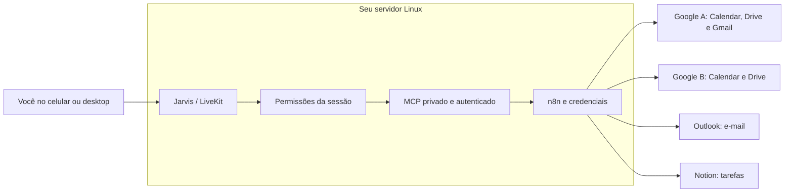

# Plano de integrações pessoais do Jarvis

Data: 23/10/2026. Status em 24/10: primeira etapa publicada (apps 1.7.0 (26), tela Conexões). Runtime de leitura (gateway no `jarvis-control`, seis ferramentas, verificação de contas, workflows n8n) pronto e empacotado, aguardando publicação com sudo; n8n de produção preparado. Contas ainda não autorizadas. A ligação ao agente usa o gateway com webhooks, alternativa prevista na etapa 4 (motivo no documento de continuidade).

O estado da entrega, o contrato da API e o trabalho seguinte estão no [documento de continuidade para o Jarvis](continuidade-jarvis-integracoes-pessoais.md). O restante deste plano descreve o objetivo completo, incluindo etapas futuras.

Preferência confirmada: hospedar os conectores e guardar as credenciais no servidor do usuário.

## Decisão recomendada

Usar **n8n Community no servidor Linux + MCP no LiveKit Agents existente**. O n8n fornece os conectores e os fluxos de consulta; o Jarvis continua responsável pela conversa e pela autorização de acesso de cada dispositivo. Não é necessário construir conectores de Google, Microsoft e Notion do zero.

O n8n possui conectores para [Calendar](https://docs.n8n.io/integrations/builtin/app-nodes/n8n-nodes-base.googlecalendar/), [Drive](https://docs.n8n.io/integrations/builtin/app-nodes/n8n-nodes-base.googledrive/), [Gmail](https://docs.n8n.io/integrations/builtin/app-nodes/n8n-nodes-base.gmail/), [Outlook](https://docs.n8n.io/integrations/builtin/app-nodes/n8n-nodes-base.microsoftoutlook/) e [Notion](https://docs.n8n.io/integrations/builtin/app-nodes/n8n-nodes-base.notion/). Seu [MCP Server Trigger](https://docs.n8n.io/integrations/builtin/core-nodes/n8n-nodes-langchain.mcptrigger.md) expõe ferramentas e workflows com autenticação. O [LiveKit Agents suporta clientes MCP em Python](https://docs.livekit.io/agents/logic/tools/mcp/).

“No meu servidor” cobre os conectores, os fluxos, as credenciais e eventual cache. Os dados originais continuam nos provedores. Os trechos devolvidos ao agente são processados pelo modelo de IA configurado no Jarvis — hoje o código usa Gemini Realtime. Tornar também o modelo totalmente local seria outro projeto.

## O que foi verificado no projeto

- `C:\J.A.R.V.I.S\jarvis\src\agent.py`: `Assistant` recebe conjuntos de ferramentas, registrados em `tools=[...]`. É o ponto natural de conexão.
- `C:\J.A.R.V.I.S\jarvis\pyproject.toml`: Python com `livekit-agents[google,images]~=1.8`; o extra `mcp` ainda não está declarado.
- Ambiente Python local: LiveKit Agents **1.8.7**. O código instalado contém `MCPToolset` e `MCPServerHTTP`, incluindo transporte `streamable_http`, headers e filtro de ferramentas. Isso confirma a base técnica, mas não constitui um teste de conexão.
- Não foram encontrados conectores das contas pessoais nos arquivos pesquisados em `src`.
- O projeto já distingue perfis/dispositivos e usa servidor Linux, helper Windows e clientes móveis. Consultas às contas devem rodar no Linux, permitindo uso mesmo com o PC desligado.
- A inspeção desta tarefa foi local. A release e os recursos disponíveis no servidor precisam ser reconfirmados antes da instalação.

## Escopo da primeira entrega

| Conexão lógica | Acesso inicial | Exemplos de uso |
| --- | --- | --- |
| Google A | Calendários, Drive e Gmail | Agenda de hoje, localizar documento, buscar mensagem |
| Google B | Calendários e Drive | Cruzar compromissos e procurar arquivos na segunda conta |
| Outlook | E-mails | Buscar, ler e resumir mensagens |
| Notion | Base(s) de tarefas autorizada(s) | Pendências, atrasadas, prazos e detalhes |

Os nomes A/B são provisórios. A implementação deve usar apelidos escolhidos pelo usuário e verificar a identidade retornada pelo provedor após o login. A conta Gmail será uma das duas contas Google, a identificar na configuração.

No n8n, criar credenciais separadas por conta e, quando necessário, por serviço: Calendar A/B, Drive A/B, Gmail A, Outlook e Notion. São sete associações de serviço; não sete identidades. Nunca selecionar uma conta por ser a última autenticada. Um parâmetro `account` deve ser validado e encaminhado para um ramo de workflow com credencial fixa.

Ao consultar ambas as contas, preservar conta e origem em cada resultado. Eventos compartilhados podem aparecer duas vezes: consolidar somente quando a identidade do evento permitir, preservando as origens. Falha em uma conta deve gerar resposta parcial identificada.

## Como conectar cada serviço

**Google:** criar um projeto no Google Cloud, habilitar Calendar, Drive e Gmail, cadastrar o cliente OAuth e autorizar as duas contas separadamente. Na instalação própria do n8n é necessário configurar esse cliente; a autenticação Google gerenciada pela plataforma é recurso do n8n Cloud. [Configuração oficial](https://docs.n8n.io/integrations/builtin/credentials/google/oauth-single-service/).

Planejar permissões de leitura: calendário, `drive.readonly` para procurar e abrir arquivos já existentes, e `gmail.readonly` somente na conta escolhida. `drive.file` limita o conjunto de arquivos acessíveis e não atende, sozinho, à busca geral pelo Drive. Conferir os escopos realmente solicitados pelos nodes: se um conector exigir escrita desnecessária, usar OAuth genérico e HTTP Request com a API oficial para essa operação. [Escopos do Drive](https://developers.google.com/workspace/drive/api/guides/api-specific-auth), [escopos do Gmail](https://developers.google.com/workspace/gmail/api/auth/scopes).

O modo OAuth externo “Testing” pode expirar o refresh token em sete dias para esses acessos. Resolver o estado do aplicativo e os requisitos aplicáveis ao uso pessoal antes de considerar a conexão permanente. Não pressupor que publicar o app dispense toda verificação. [Expiração dos tokens Google](https://developers.google.com/identity/protocols/oauth2/).

**Outlook:** registrar o aplicativo Microsoft, configurar o callback e autorizar acesso delegado ao e-mail. Usar `Mail.Read` e renovação de sessão; escolher o tipo de conta adequado, incluindo suporte a conta pessoal se for Outlook.com/Hotmail. Uma organização pode exigir consentimento do administrador. [Configuração no n8n](https://docs.n8n.io/integrations/builtin/credentials/microsoft/), [API de e-mail Microsoft Graph](https://learn.microsoft.com/en-us/graph/api/resources/mail-api-overview?view=graph-rest-1.0).

**Notion:** preferir conexão interna com acesso de leitura apenas às páginas/bases de tarefas escolhidas, quando o usuário tiver permissão para criá-la. Compartilhar essas páginas com a conexão. Mapear os campos reais de título, status, prazo, responsável e projeto; as tarefas podem ser linhas de uma base ou blocos de checklist. O conector deve respeitar essa estrutura, sem presumir nomes de propriedades. O MCP remoto oficial do Notion existe, mas a proposta usa o conector local do n8n acessando a API. [Autorização do Notion](https://developers.notion.com/docs/authorization), [MCP oficial](https://developers.notion.com/docs/mcp).

## Ferramentas que o Jarvis receberá

Expor inicialmente cerca de seis ferramentas de consulta, com contratos pequenos:

| Ferramenta proposta | Comportamento |
| --- | --- |
| `calendar_list_events` | Consulta período e contas selecionadas; retorna calendário e fuso |
| `drive_search` | Pesquisa arquivos com conta, título, tipo e link |
| `drive_read` | Abre um arquivo localizado; exporta documentos Google quando necessário |
| `mail_search` | Busca Gmail, Outlook ou ambos, preservando remetente e conta |
| `mail_read` | Lê a mensagem selecionada com corpo limitado e metadados |
| `notion_list_tasks` | Filtra tarefas por status, prazo e projeto; retorna link e detalhes úteis |

Retorno comum: origem, conta, identificador, link quando disponível, instante da consulta, conteúdo limitado e indicação de truncamento/continuação. Identificadores devem sempre ser acompanhados da conta correspondente.

Começar por busca sob demanda. No Drive, localizar candidatos e ler apenas os arquivos úteis; suportar inicialmente documentos Google exportáveis, texto e PDFs com texto. PDFs digitalizados, OCR e formatos adicionais ficam para uma etapa seguinte. O RAG local existente pode receber pastas selecionadas depois, com controle de atualização e remoção de acesso. A primeira entrega não depende de indexar todo o Drive ou todas as mensagens.

## Etapas de implementação

1. **Preparar a base:** conferir servidor e release; instalar n8n em Docker Compose com versão fixada, volume persistente, backup do banco e da chave de criptografia. Usar uma instância simples e acesso administrativo restrito. Configurar HTTPS/callback OAuth acessível pelo navegador usado na autorização. Publicação geral dos endpoints internos não é necessária para consultas sob demanda.
2. **Conectar as contas:** configurar os clientes Google/Microsoft, autorizações e Notion; conferir identidades, escopos, renovação e desconexão. Guardar segredos no servidor, fora do Git, do frontend e dos prompts.
3. **Montar os workflows:** primeiro agenda e Notion; depois pesquisa/leitura de e-mails e Drive. Usar nodes prontos, paginação e normalização. Usar HTTP Request somente nas lacunas dos conectores. Nenhum segundo agente de IA é necessário dentro do n8n.
4. **Ligar ao LiveKit:** declarar o extra MCP preservando Google/images; adicionar `MCPToolset` com ID estável e `MCPServerHTTP` autenticado via `streamable_http`. Expor somente os workflows selecionados pelo MCP Server Trigger. Se surgir incompatibilidade concreta, manter os mesmos workflows por webhooks autenticados e pequenas `function_tool` Python. Não trocar todo o sistema por causa do transporte.
5. **Validar e publicar:** cenários de texto, debugger LiveKit e sessão real por voz. Medir latência e regressão; implantar com rollback e feature flag para desabilitar a integração.

Estimativa de planejamento: **4–7 dias de trabalho para uma primeira versão validada**, supondo acesso ao servidor e autorizações disponíveis. Não é prazo contratual; revisões OAuth, consentimento administrativo e formatos difíceis de arquivos podem ampliar o calendário. Uma tela própria de “Conexões” no Orquestrador fica para depois: o painel n8n serve à configuração inicial.

## Regras de funcionamento

- Acrescentar uma permissão explícita de dados pessoais aos dispositivos autorizados. O perfil `work_access` não deve liberar e-mail e Drive pessoais automaticamente. A identidade vem da sessão autenticada, não de um argumento inventado pelo modelo.
- Disponibilizar o MCP pessoal somente às sessões autorizadas, com autenticação própria entre Jarvis e n8n. O modelo não recebe a chave nem ferramentas administrativas do n8n.
- A primeira entrega consulta dados. Enviar e-mails, alterar eventos e concluir tarefas são expansão posterior, com permissões específicas e confirmação da ação concreta.
- Tratar conteúdo de e-mails, documentos e páginas como dados, sem executar instruções encontradas dentro deles.
- Definir limites de resultados, tamanho, duração e repetição; permitir cancelar consultas. Se um provedor falhar, o restante do Jarvis continua disponível e a resposta informa a limitação.
- Reduzir retenção dos conteúdos nas execuções n8n e nos logs/transcrições do Jarvis; registrar preferencialmente status, duração e origem. Cache, quando usado, deve indicar idade e ser invalidado ao desconectar a conta.

## Critérios de aceite

- “O que tenho hoje nas duas agendas?” consulta os calendários habilitados de ambas as contas, com fuso `America/Sao_Paulo`, eventos de dia inteiro e recorrências corretos.
- “Procure o documento X nos meus Drives” retorna origem e link; “leia este” abre o arquivo certo, mesmo com nomes iguais em contas diferentes.
- “Ache o e-mail de Y” pesquisa Gmail e Outlook sem trocar remetente, conta ou conversa e sem marcar como lido.
- “Quais tarefas estão atrasadas no Notion?” usa os status e os prazos da base real.
- Reiniciar Jarvis/n8n preserva as conexões; renovar o token não exige novo login normal a cada consulta.
- Revogar uma conta bloqueia novas leituras e não reapresenta resultados antigos como atuais.
- Uma sessão sem permissão de dados pessoais não lista nem executa essas ferramentas.
- Falha ou timeout em uma conta gera resultado parcial explícito; n8n indisponível não impede conversa e ferramentas existentes.
- Consultas funcionam com o PC Windows desligado, mantendo servidor Linux e conectividade disponíveis.
- Voz, interrupção e ferramentas antigas passam pelos cenários existentes. Seguir `AGENTS.md` do Jarvis: cenário antes de alterar comportamento, formatação/lint, simulação e debugger antes de declarar conclusão.

## Alternativas e custos

| Opção | Avaliação para este caso |
| --- | --- |
| n8n Community + MCP | Recomendação: conectores prontos, configuração visual e hospedagem própria; exige manter mais um serviço |
| Bibliotecas direto no Python | Menos infraestrutura adicional, mas mais implementação de OAuth, armazenamento, busca e manutenção |
| Composio gerenciado | Cobre os serviços e múltiplas contas, mas acrescenta um intermediário externo; não atende à preferência confirmada |

Se futuramente for necessário remover o n8n, reaproveitar os contratos das ferramentas com `google-api-python-client`/`google-auth-oauthlib`, Microsoft Graph SDK e API REST do Notion. O Notion tem SDK oficial JavaScript; não tratar wrappers Python de terceiros como oficiais. [Bibliotecas Google](https://developers.google.com/workspace/drive/api/quickstart/python), [Microsoft Graph em Python](https://learn.microsoft.com/en-us/graph/tutorials/python), [autorização e SDK Notion](https://developers.notion.com/docs/authorization).

A [edição Community do n8n é gratuita](https://docs.n8n.io/hosting/community-edition-features/). Permanecem os custos de servidor, armazenamento/backup e modelo de IA, além de limites dos provedores. Dimensionar o consumo com o fluxo real antes de aumentar a máquina. Os recursos pagos de compartilhamento entre administradores não são requisito deste uso pessoal.

Para iniciar a configuração serão necessários os apelidos das contas, a identificação do Gmail escolhido, os calendários habilitados, a base de tarefas do Notion e um endereço HTTPS para o callback. Essas decisões não impedem o planejamento; os logins e consentimentos serão feitos pelo usuário no provedor, sem compartilhar senhas no chat.
