# Relatórios automáticos do DiceVTT — entrega para Claude

Data: 25/10/2026 · Escopo desta entrega: planejamento + UI no site existente.

## 1. Pedido e estado da entrega

Ao abrir `iniciar-tudo.cmd`, gerar automaticamente um relatório do DiceVTT no PC e mostrá-lo no Orquestrador. Usar o n8n do servidor para receber resultados, coordenar investigação opcional e manter histórico. A interface deve continuar abrindo mesmo quando a coleta, o RAG ou o servidor falharem.

**Estado em 25/10/2026 (após a implementação das entregas 1 e 2):**

- **Feito:** runner `services/diagnostics` (127.0.0.1:8768, supervisionado pelo helper como serviço opcional), perfil leve real, SQLite, JSON/HTML com hash, comparação entre runs, preferências no disco com revisão, ponte `services/audits-bridge.mjs` e UI `/#reports` ligada à API (histórico, detalhe, "Gerar agora" idempotente, cancelar, importar rascunho antigo). O `iniciar-tudo.cmd` pede o relatório antes da bifurcação e abre `/#reports`. Duas aberturas reais pelo CMD geraram `AUD-20261025-211224-8b46a9` e `AUD-20261025-211715-028c9f`. Detalhes: [services/diagnostics/README.md](../services/diagnostics/README.md).
- **Feito em seguida (entregas 4 e 5):**
  - Perfil `full-audit`:
    - Snapshot da cópia de trabalho com hash e `persistentDataPath` isolado (sufixo no `productName`, sistemas provisionados como cópia).
    - Cache próprio de `Library`.
    - Importação e compilação, referências de assets, EditMode quando houver testes e os 9 validadores em lote do próprio projeto.
    - Integridade da origem conferida no fim.
    - Unity com prioridade baixa num job object próprio.
  - Investigação por IA em fila própria, com provedor local (AirLLM/RAG) ou Claude Code com autorização explícita. Hipóteses só ficam `supported` com fonte real e ficam num arquivo separado. Detalhes: [services/diagnostics/README.md](../services/diagnostics/README.md).
- **Ainda não implementado:** entrega 3 (outbox, mensagens no helper/gateway, workflows n8n A/B). Ela exige alterações e deploy no servidor. Nada foi publicado no servidor e nenhum código do jogo foi alterado.
- **Fatos novos que mudam o plano:**
  - O DiceVTT é versionado pelo **Unity Version Control** (`.plastic`, changeset 189). O Git em `C:\ProjetoTablepRPG` só contém um README, então a entrega 4 usa uma cópia da pasta, não `git worktree`.
  - O projeto não tem assembly de testes: EditMode fica "não executado", e a cobertura real vem dos validadores em lote que o projeto já tem.

O rascunho antigo do navegador (`implementation_status: ui_only`) só entra por importação explícita no formulário e precisa ser salvo para valer. A prévia tem `kind: example` e permanece separada de qualquer dado real.

## 2. Inventário observado, sem presumir disponibilidade

| Item | Evidência local em 25/10/2026 | Consequência |
| --- | --- | --- |
| Orquestrador | `D:\Programação\ProjetoLocais\Orquestrador`, React/TS/Vite, porta 1420 | Estender a aplicação; não criar outro site |
| Inicializador | `iniciar-tudo.cmd`: helper, espera do RAG por até 90 s, abre `/#rag`, reutiliza Vite existente | Inserir o disparo antes da bifurcação “site já está aberto”; nunca depender da montagem do React |
| Helper | `C:\J.A.R.V.I.S\jarvis`, iniciado pelo CMD, responsável por RAG/ingestão | Reaproveitar supervisão e transporte autenticado; inspecionar código antes de implementar |
| RAG / ingestão | Ponte existente: 8767 / 8766 | Reusar APIs e não criar outra base vetorial |
| Projeto Unity | `C:\ProjetoTablepRPG\DiceVTT` | Origem somente leitura para coleta |
| Git do projeto | `git -C ...\DiceVTT rev-parse --show-toplevel` retorna `C:/ProjetoTablepRPG` | Worktree é do repositório pai; Unity fica em `<worktree>\DiceVTT` |
| Unity | `ProjectVersion.txt`: `6000.3.10f1`; diretório instalado com a mesma versão | Detectar executável e revisar licença em tempo de execução |
| Test Framework | `Packages/manifest.json`: `com.unity.test-framework: 1.6.0` | Há dependência declarada; ainda conferir assemblies e testes descobertos |
| n8n | `deploy/personal-integrations/compose.yaml`: imagem 2.44.6 fixada por digest, porta do host `127.0.0.1:5679` → container 5678 | Não expor 5679 na LAN nem presumir que localhost no container é o Windows |
| Servidor | Guia local: `user@your-server-ip`; painel por túnel SSH | Endereço documentado, não verificado ao vivo nesta tarefa |
| Timeout n8n | Compose atual: 60 s; máximo 120 s | Usar eventos curtos, sem deixar execução esperando testes Unity |
| Retenção n8n | Execuções bem-sucedidas e com erro não são salvas no compose | Histórico da auditoria deve ter persistência própria |
| Orquestrador sem Git | `git status` nesta pasta informa que não é repositório | Não inventar commit do Orquestrador; fazer backup antes de alterar componentes externos |

Validadores existentes que podem ser adaptados depois de leitura completa:

- `C:\ProjetoTablepRPG\DiceVTT\Assets\Scripts\Fichas\Cyberpunk\FichaAlpha\Editor\ConferenciaFichaCyberpunkAlpha.cs`: método `ConferirEmLote`, saída `-relatorioCyberpunk`, cena temporária, encerra o Editor com código de saída. É simulação no Editor, não cobertura de PlayMode.
- `C:\ProjetoTablepRPG\DiceVTT\Assets\Scripts\criacaoFichasModular\Editor\ValidacaoDeTelaModular.cs`: método `ValidarEmLote`, saída `-relatorioModular`, exige dados/sistemas instalados adequados. A primeira parte do arquivo declara que a escrita de fichas é desativada durante a validação.

Essas leituras identificam candidatos; não demonstram sucesso ou segurança de uma execução completa. Conferir efeitos, dependências e caminhos de dados antes de usá-los na cópia isolada.

## 3. Arquitetura escolhida

```mermaid
flowchart LR
  CMD[iniciar-tudo.cmd] -->|pedido idempotente| R[Runner Windows]
  UI[Site: Relatórios] -->|ponte local| R
  R --> G[Git, versões e logs]
  R -->|perfil completo| U[Unity em cópia isolada]
  G --> L[SQLite + JSON/HTML locais]
  U --> L
  L --> O[Outbox persistente]
  O --> H[Canal autenticado do helper]
  H --> J[Gateway Jarvis no servidor]
  J --> N[n8n: receber auditoria]
  N --> D[Histórico central via API]
  N -->|opcional, job assíncrono| A[Orquestrador: auditor + RAG/MCP]
  A --> E[Evento de conclusão]
  E --> F[n8n: consolidar investigação]
  F --> D
```



**PC:** runner Python, Git, Unity, coletores, JSON/HTML, SQLite e fila de sincronização. O relatório básico é determinístico e funciona sem IA, internet ou servidor. Começar com SQLite evita instalar PostgreSQL só para a primeira fase.

**Servidor:** gateway existente, n8n existente e histórico de metadados. Primeiro usar armazenamento da aplicação Jarvis, após conferir migrations e backup. PostgreSQL pode ser adotado se já houver uma instância adequada; não usar o banco interno do n8n como banco da aplicação e não escrever diretamente nas tabelas dele.

**IA:** opcional, modelo escolhido no orquestrador. A presença do AirLLM não garante throughput para auditoria completa. A primeira versão não envia código bruto nem logs completos para provedores. Se o usuário escolher IA local, implementar consulta local e limites; sem modelo disponível, registrar `skipped` e preservar o relatório básico.

**Transporte escolhido:** PC inicia conexões pelo helper/Jarvis, sem API do runner acessível na rede. O servidor não chama `127.0.0.1` do PC. Adicionar mensagens tipadas ao canal existente se necessário, com ACK e reenvio. O túnel SSH é apenas administrativo. HTTP direto por VPN é alternativa futura, não dependência do MVP.

## 4. Comportamento exato de iniciar-tudo.cmd

Implementar `scripts/request-startup-audit.ps1` e o comando do runner `request-startup`, com limites finitos. Não usar `Invoke-Expression`, shell recebido por JSON ou arquivo de exemplo como entrada operacional.

1. Preservar a inicialização atual do helper/RAG. O runner deve ser supervisionado pelo helper, sem segundo supervisor concorrente.
2. Antes de testar se a porta 1420 já está ocupada, iniciar o script de solicitação em segundo plano (`Start-Process -WindowStyle Hidden`, argumentos e caminhos corretamente citados).
3. O script cria um `startup_id` UUID **uma vez**, aguarda `/health` do runner por no máximo 30 s e faz `POST /v1/audits` com timeout de 5 s. No máximo duas tentativas, usando a mesma chave. Falha é registrada em `.local/audits/logs/startup.log`; não bloqueia nem encerra a UI.
4. Uma segunda abertura cria outro `startup_id`. Se houver auditoria ativa do mesmo projeto/perfil, o runner associa esse pedido à auditoria ativa e retorna `coalesced: true`. Quando o job anterior termina, uma nova abertura gera novo relatório, mesmo que o commit seja igual. **Não usar apenas commit ou data como chave de idempotência.**
5. Duplo clique simultâneo deve ser resolvido por transação/constraint no runner. Relação `startup_requests(startup_id UNIQUE, run_id)` mantém rastreabilidade dos pedidos agregados.
6. Abrir `/#reports` nas duas ramificações do CMD, ou manter `/#rag` se essa preferência for adotada depois. A UI nunca dispara por refresh, mudança de rota ou StrictMode.
7. Se “gerar na abertura” estiver desativado na configuração real, não executar. Registrar explicitamente desativado no status, sem inventar relatório.
8. Integrar parada ao ciclo de vida do helper e a `parar-tudo.cmd`: checkpoint, interromper apenas processos filhos pertencentes ao job, salvar `cancelled` ou `interrupted` e preservar outbox. Nunca encerrar toda instância de Unity por nome.

O rascunho de `localStorage` atual não é legível pelo CMD. Na fase real, substituir por `GET/PUT /api/audits/settings`, persistindo configuração no serviço. Oferecer importação explícita do JSON exportado; não manter duas fontes de configuração silenciosas.

## 5. Perfis e evidências

| Perfil | Verificações | Limite inicial proposto |
| --- | --- | --- |
| `startup-light` (padrão) | Git/revisão/dirty, versões, dependências declaradas, recorte de logs, disponibilidade RAG/MCP | 90 s; um job por projeto |
| `full-audit` | Perfil leve + preparar cópia, compilação, EditMode e validadores de assets | 30 min por execução Unity; 60 min total |
| Futuro, sob demanda | PlayMode, build, profiler, Roslyn e regras específicas de mapas/tokens | Definir depois de medir; não ativar tudo a cada abertura |

No perfil leve não abrir Unity, iniciar builds nem executar validadores no Editor principal. Os logs podem ser antigos e compartilhados entre projetos; registrar origem, intervalo temporal, tamanho/offset lido, hash e correspondência com o projeto. Sem correspondência confiável: `stale`/`partial`, nunca “erro atual confirmado”. Limitar leitura inicial a 2 MB e redação de credenciais antes de envio.

Git: registrar raiz real, caminho relativo do projeto, commit (nullable), branch e alterações locais. Se `dirty`, a análise de arquivos atuais precisa de hashes próprios. Uma cópia de `HEAD` não inclui mudanças não commitadas nem arquivos ignorados; o relatório deve mostrar `source_state: working_tree` ou `source_state: committed_snapshot` e não apresentar ambos como a mesma revisão.

Cópia proposta: diretório fora do repositório principal, por exemplo `C:\DiceVTT-Audit\worktrees\<run_id>\DiceVTT`. Resolver paths, proibir a origem e sobreposições, conferir links/junctions. Worktree compartilha metadados Git; não é sandbox de credenciais. Não copiar `.env`, tokens ou configurações pessoais. Provisionar apenas fixtures/dados necessários. `Library` separada e sem compartilhar Editor aberto. Inspecionar hooks de Editor e integrações externas antes de executar o projeto.

Unity: confirmar versão exata instalada, `-projectPath` isolado, licença, espaço em disco e lock. Usar `subprocess` com lista de argumentos, timeout e processo filho identificado. Para testes, usar `-batchmode -runTests -testPlatform EditMode -testResults <xml> -logFile <log>`; não acrescentar `-quit` indiscriminadamente ao Test Runner. Validadores `-executeMethod` têm política própria de encerramento. `-nographics` precisa ser avaliado conforme o teste e não serve para testes que exigem renderização.

Saída de processo sozinha não comprova aprovação: analisar XML/log, número de testes, falhas de compilação, ausência de XML e timeout. Zero testes deve ser distinguido de testes aprovados. Incluir etapa não executada com motivo. Nenhuma ocorrência deve ser marcada resolvida se o check correspondente foi pulado, falhou em coletar ou mudou de escopo.

## 6. Serviço local e contratos propostos

Estrutura futura (não criada nesta entrega):

```text
services/diagnostics/
  src/dicevtt_diagnostics/{api.py,jobs.py,store.py,outbox.py,settings.py}
  src/dicevtt_diagnostics/collectors/{git.py,unity_logs.py,unity_tests.py,assets.py}
  tests/
services/audits-bridge.mjs
scripts/request-startup-audit.ps1
deploy/audits/{build_workflows.py,workflows/,README.md}
.local/audits/{config.json,audits.sqlite,logs/,runs/}
```

Porta proposta: `127.0.0.1:8768`, **verificar conflito antes**. Credenciais somente no serviço/helper, com ACL de usuário Windows; nenhuma chave no browser, links ou exportação de rascunho. Operações fixas, projeto por ID, sem aceitar caminhos arbitrários de clientes. Proteger Host/Origin/CSRF no adaptador como nas pontes existentes. Sem CORS amplo. O runner valida token mesmo no loopback.

| API local do runner | Ponte do site | Contrato |
| --- | --- | --- |
| `GET /health` | `GET /api/audits/health` | versão, capacidades, configurações ativas, status de sync |
| `GET/PUT /v1/settings` | `GET/PUT /api/audits/settings` | configuração versionada; validação e gravação atômica |
| `POST /v1/audits` | `POST /api/audits` | 202 com run_id; 200 para repetição; chave idempotente obrigatória |
| `GET /v1/audits?cursor=...&limit=20` | `GET /api/audits` | lista paginada e filtros validados |
| `GET /v1/audits/{id}` | `GET /api/audits/{id}` | estado, checks, cobertura e achados |
| `GET /v1/audits/{id}/report?format=json\|html` | equivalente | arquivo gerado, sem path fornecido pelo cliente |
| `POST /v1/audits/{id}/cancel` | equivalente | cancelamento cooperativo e idempotente |

`POST` proposto: header `Idempotency-Key: <startup_id>`, body:

```json
{
  "project": "DiceVTT",
  "trigger": "startup",
  "startup_id": "UUID",
  "profile": "startup-light",
  "auto_fix": false
}
```

Estados de job: `queued → collecting → completed | partial | failed | cancelled | interrupted`. No reinício, jobs sem processo vivo vão para `interrupted`; não reexecutar Unity silenciosamente. Estado de sync independente: `local_only | pending | synced | failed`. A UI mostra último resultado conhecido com data quando offline e evita confundir falha de rede com ausência de achados.

Documento `schema_version: 1`: run_id, startup_ids, project, trigger, profile, UTC timestamps, duração, revision `{git_root, project_relative_path, commit, dirty, source_state}`, checks, findings, cobertura, artefatos e sync. Datas exibidas em `America/Sao_Paulo`.

Achado: fingerprint estável por regra + GUID/path normalizado + objeto/propriedade + assinatura, severidade, estado `suspected|confirmed|resolved|rejected`, resumo, file/line nullable, evidências por ID/hash, origem `collector|ai`, testes recomendados. Não usar número de linha como identidade exclusiva. Comparar runs de cobertura compatível; distinguir `new`, `recurring`, `resolved`, `not_rechecked`.

Persistência local: tabelas `audit_runs`, `startup_requests`, `check_results`, `findings`, `run_findings`, `artifacts`, `outbox`; transação única para finalizar run e criar evento. Relatórios renderizados a partir de JSON validado, HTML escapado sem scripts, limites de tamanho, nomes gerados pelo serviço. Evidências são dados não confiáveis, nunca instruções para o modelo ou para o shell.

## 7. n8n: links e fluxos que o Claude deve implementar

Painel documentado: `http://localhost:5679`, acessível no PC após:

```sh
ssh -N -L 5679:127.0.0.1:5679 user@your-server-ip
```

Após criar o workflow, copiar a URL real do editor `/workflow/<id>` para “Fluxo e conexões”. Nenhum ID foi inventado na UI. URL de webhook não é link de navegação nem deve carregar segredo em query string.

Os caminhos abaixo são **propostos**, ainda não publicados. Usar Header Auth dedicado (`X-DiceVTT-Audit`) entre gateway e n8n, diferente do segredo das integrações pessoais. O browser e modelos não recebem essa credencial.

### Workflow A — DiceVTT · Receber auditoria

| Nó | Configuração/ação planejada |
| --- | --- |
| Webhook | POST `/webhook/dicevtt-audit-completed-v1`, Header Auth, resposta pelo nó Respond to Webhook |
| Validate event | Code: schema_version, event_id, run_id, device_id autorizado, tipo fixo, limites; rejeitar example/draft e executed:false |
| Persist event | HTTP Request para API interna do gateway: persistência transacional + UNIQUE(event_id); ACK só após commit |
| Respond to Webhook | 200 com event_id e accepted:true; repetição aceita retorna duplicate:true; erro persistente retorna não-2xx |

Persist event grava o relatório e, se configurado, um job de investigação na fila durável do servidor na mesma transação. Um worker do orquestrador consome a fila depois. Isso evita aceitar o evento e perder a investigação se n8n cair logo após responder. Não esperar inferência nem Unity neste workflow.

Evento proposto: `{schema_version:1,event_id,type:"audit.completed",device_id,run_id,report_revision:1,report}`. Report limitado a 512 KB de JSON resumido; logs e binários ficam locais. Caso seja necessário upload de artefatos, criar endpoint autenticado com limite/hash, em etapa separada.

### Workflow B — DiceVTT · Consolidar investigação

Webhook POST `/webhook/dicevtt-audit-investigation-v1` autenticado → validar evento `audit.investigation.completed` → HTTP Request ao gateway → Respond to Webhook. Correlacionar run_id + job_id + versão do relatório; rejeitar conclusão obsoleta ou duplicada. Persistir hipóteses e referências sem sobrescrever evidências dos coletores. Confiança de IA não substitui validação.

### Fluxo futuro de auditoria solicitada pelo servidor

Schedule/Webhook → gateway cria comando tipado com TTL → helper busca/recebe quando PC estiver online → runner aceita e devolve run_id → conclusão via workflow A. PC desligado não gera sucesso e não deve provocar um loop infinito de polling. A rotina principal pedida aqui continua sendo disparada localmente pelo CMD.

Dentro do container n8n, a API do gateway precisa de endereço realmente alcançável: rede Docker privada/alias ou host gateway aprovado, com bind restrito. Inspecionar implantação antes de definir hostname/porta; nunca colar `127.0.0.1:<porta do host>` presumindo funcionar no container.

Outbox local: reenvio com mesmo event_id, backoff 5 s → 30 s → 2 min → 10 min com jitter; offline persistente mantém pendente. 401/403 pausam envio e exibem configuração inválida. Não marcar synced antes do ACK com event_id correto. Deduplicar pelo ID; hash conflitante no mesmo ID é erro. Retenção inicial proposta: 30 dias de artefatos concluídos, 90 dias de metadados; não apagar evento pendente nem seu relatório antes de sincronizar/exportar. Limitar disco e sinalizar fila cheia.

Não alterar workflows pessoais existentes, volume, encryption key ou timeouts globais. Criar workflows próprios desativados, importar em ambiente de teste, conferir o esquema dos nodes na versão instalada e só então publicar. O gerador de JSON deve permanecer no repositório como ocorre com os workflows pessoais. Esta entrega descreve o fluxo, mas não fornece JSON que finja ser um workflow já funcional/importável.

## 8. Evolução da UI entregue

Arquivos: `src/ReportsPanel.tsx`, `src/reports.ts`, `src/reports.css`, navegação em `src/App.tsx` e tipo `Page` em `src/domain.ts`. O Markdown deste plano é importado com Vite `?raw` para download. A UI acompanha o tema existente e adapta colunas no celular.

Conectar a API substituindo o estado vazio por lista real e dados de saúde. Manter badge de rascunho até o runner confirmar configuração persistida. Exemplo deve continuar acessível por ação explícita e fora de histórico/métricas. Não mostrar “zero falhas” quando não houve auditoria. Exibir `parcial`, `não executado`, erro de coleta e indisponibilidade de forma distinta.

Ao concluir: histórico paginado, detalhe técnico, JSON/HTML reais, filtro por estado/gravidade, botão “Gerar agora” com idempotência e bloqueio de duplicatas, cancelar job ativo, progresso pelos checks realmente concluídos (sem porcentagem inventada), status e data da última sincronização, link de execução n8n quando conhecido. Nunca fazer `dangerouslySetInnerHTML` com logs ou texto do modelo.

## 9. Ordem de execução e critérios de aceite

### Entrega 1 — relatório local real

Implementar runner, configuração no disco, SQLite, perfil leve, JSON/HTML e API. Adaptar UI e ponte em `vite.config.mjs` (dev e preview). Servir apenas loopback, validar origem e autenticação. O empacotamento Tauri de produção continua precisando de ponte nativa; não considerar build web como solução do instalador.

Aceite: falha de Git, log ausente/antigo, RAG offline e nenhuma ocorrência são cenários distintos; hashes, data e cobertura presentes; relatório legível e escapado; leitura não modifica projeto.

### Entrega 2 — abrir o CMD gera o relatório

Adicionar supervisão no helper, script de startup, disparo em ambas as situações de Vite e parada limpa. A configuração real deve estar habilitada conforme pedido do usuário após implantação validada.

Aceite: abrir com Vite desligado e já ligado, repetir pedido/reabrir durante coleta, serviço lento/offline, desabilitar rotina, encerrar helper durante job e reiniciar. O site abre, não há duplicatas do mesmo startup_id e não há processo órfão. Após instalação, testar o próprio CMD e apresentar um relatório **real** ao usuário.

### Entrega 3 — sincronizar e ligar o n8n

Implementar mensagens tipadas no helper/gateway, armazenamento central, outbox, workflows A/B e link real no site. Confirmar acesso e backup do n8n existente antes da publicação.

Aceite: desconectar servidor após gerar relatório, reiniciar PC/runner, reconectar e reenviar; apenas um registro central. Recusa sem autenticação; callback inválido/obsoleto recusado; ACK perdido não duplica; erro no armazenamento não gera ACK de sucesso; falha do novo workflow não afeta integrações pessoais.

### Entrega 4 — auditoria completa isolada

Preparar snapshot identificável, compilação, EditMode e adaptação de validadores existentes. Validar assets e referências sem salvar cenas no projeto principal. Expandir para PlayMode e build após medir custo.

Aceite: raiz Git pai tratada corretamente, origem com Editor aberto não é reutilizada, dirty identificado, teste falhando/zero testes/XML ausente/timeout/licença indisponível registrados, cancelamento mata apenas o processo do job, hash dos arquivos originais permanece igual.

### Entrega 5 — investigação opcional por IA

Reaproveitar orquestrador + RAG + MCP, limite de contexto/custo/tempo, saída validada, hipóteses separadas e links para evidências. Não indexar hipóteses como documentação factual. Correção automática, branches de correção e integração ao projeto ficam fora deste pedido de relatórios.

Aceite: modelo indisponível não impede relatório básico; código não é enviado para provedor sem configuração compatível; nenhum agente confirma falha sem fonte; timeout é explícito; relatório central e local conservam origem e versão da investigação.

## 10. Validação desta UI e referências

Executar no Orquestrador:

```powershell
npm.cmd run build
npm.cmd test
npm.cmd run test:ui -- tests/ui/reports.spec.ts tests/ui/workspace.spec.ts
```

O teste do vault existente em workspace depende do ambiente local. Testes novos de relatórios devem usar navegador isolado, não executar auditoria nem chamar webhooks reais. Testar também viewport 390/1024/1440, recarregar rascunho, storage indisponível, URL maliciosa e exportação com marcadores de rascunho/exemplo preservados.

Fontes locais: `iniciar-tudo.cmd`, `parar-tudo.cmd`, `vite.config.mjs`, `README.md`, `docs/integracao-companion.md`, `docs/continuidade-jarvis-integracoes-pessoais.md`, `deploy/personal-integrations/README.md`, `deploy/personal-integrations/compose.yaml`, ProjectVersion/manifest e scripts Unity citados acima. O RAG foi consultado; detalhes de scripts candidatos foram conferidos diretamente no disco.

Documentação oficial consultada para o desenho: [Webhook n8n](https://docs.n8n.io/integrations/builtin/core-nodes/n8n-nodes-base.webhook/) (URLs de teste/produção e publicação) e [Wait n8n](https://docs.n8n.io/integrations/builtin/core-nodes/n8n-nodes-base.wait/) (espera persistida e retomada). Apesar de Wait existir, a proposta prefere eventos curtos devido à configuração atual do servidor. [Test Framework, linha de comando](https://docs.unity3d.com/Packages/com.unity.test-framework@1.4/manual/reference-command-line.html) foi usado como referência inicial; conferir documentação e implementação do pacote **1.6.0 instalado** antes de fixar argumentos e códigos de saída.

## Instrução pronta para repassar

> Leia `docs/plano-relatorios-automaticos-claude.md` e a UI `/#reports`. Implemente as entregas 1 e 2 primeiro: geração real local a cada abertura de `iniciar-tudo.cmd`, persistência, estado real na UI e falhas explícitas. Depois implemente o transporte e os workflows n8n da entrega 3, preservando o n8n pessoal existente. Reutilize o helper Jarvis e as pontes atuais. Confira os caminhos reais e a raiz Git pai; não rode Unity batchmode no projeto principal. Use o JSON de preferências exportado, se fornecido, como rascunho para revisão/importação. Não trate exemplos como execuções, não ative correção automática e não marque a tarefa concluída sem demonstrar um relatório real gerado pelo CMD.
